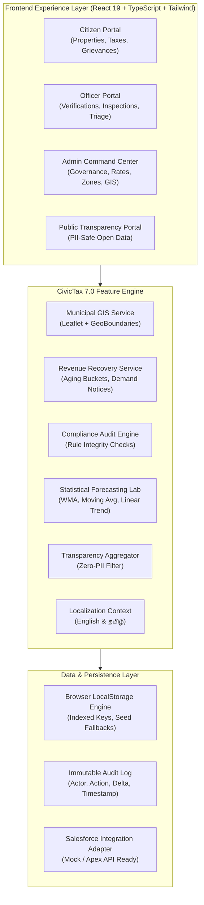

# CIVICTAX 7.0 — Smart City Intelligence, GIS & Digital Governance Platform Overview

## 1. Executive Summary

CivicTax 7.0 elevates the municipal property tax administration suite into a connected Smart City Digital Governance Platform. Building upon the foundational tax calculation, multi-role portals (Citizen, Officer, Administrator), and Command Center from versions 2.0 through 6.0, CivicTax 7.0 introduces:

1. **Municipal Geospatial (GIS) Property Intelligence**: Interactive spatial mapping of tax parcels, vector coordinates, zone boundaries, and valuation choropleths.
2. **Revenue Recovery & Aging Center**: Formal recovery triage with delinquent tax aging brackets (`1-30`, `31-60`, `61-90`, and `>90` days), automated case generation, officer assignments, and demand notice generation.
3. **Data Integrity & Compliance Center**: Explainable rule-based auditor detecting deed reference gaps, base-rate arithmetic deviations, and payment-to-assessment mismatches.
4. **Revenue Forecasting Lab**: Transparent statistical forecasting models (Moving Average, Weighted Moving Average, Linear Velocity) with confidence interval bands and scenario parameters.
5. **Citizen Public Transparency Portal**: PII-free open municipal data portal publishing aggregate ward collections, compliance rates, and municipal revenue breakdowns.
6. **Bilingual Localization (English & Tamil)**: Seamless in-app language switching powered by structured dictionary translation context.
7. **Production Quality & Zero Regressions**: 100% test pass rate across 20 Vitest test suites and sub-2-second optimized production bundle builds.

---

## 2. System Architecture & High-Level Topology

---

## 3. CivicTax 7.0 Feature Modules

| Module | Route(s) | Primary Beneficiary | Core Capabilities |
| :--- | :--- | :--- | :--- |
| **Municipal GIS** | `/admin/gis`, `/officer/gis` | Municipal Engineers, Revenue Officers | Interactive map, parcel pinpointing, zone overlays, tax category filters, coordinates inspector. |
| **Revenue Recovery** | `/admin/recovery`, `/officer/recovery` | Recovery Officers, Tax Collectors | Aging analysis (0-30, 31-60, 61-90, 90+ days), case status updates, officer assignment, CSV export. |
| **Compliance Center** | `/admin/compliance`, `/officer/compliance` | Internal Auditors, Vigilance Officers | Rule-based data checks: `RULE_PROP_DEED_CHECK`, `RULE_BASE_TAX_CONSISTENCY`, `RULE_OVERPAYMENT_DETECTION`. |
| **Forecasting Lab** | `/admin/forecasting` | Municipal Commissioner, Finance Dept | Moving average, weighted moving average, and linear trend projection with customizable horizons and confidence intervals. |
| **Public Transparency** | `/transparency` | Citizens, Press, Civil Society | PII-free public dashboard featuring total assessed tax, collections, collection efficiency, and zone performance. |
| **Tamil Localization** | In-Header Language Selector | Tamil-speaking Citizens & Municipal Staff | Dynamic instant switching between English and Tamil (தமிழ்) across all navigation labels and metrics. |

---

## 4. Technology Stack

- **Framework**: React 19 + TypeScript 5.9 + Vite 8.3
- **Styling**: Tailwind CSS with custom CivicTax institutional design system (Navy `#101D32`, Royal Indigo `#405CF5`, Emerald `#13A58B`, Slate `#64748B`, Canvas `#F5F7FB`)
- **Mapping & Geospatial**: Leaflet + React-Leaflet with OpenStreetMap vector tiles and synthetic coordinate generation
- **State & Persistence**: React Context + Indexed LocalStorage with seed fallback
- **Testing**: Vitest with jsdom simulation (20 unit & integration tests)
- **Icons & Motion**: Lucide React + custom CSS transitions

---

## 5. Verification & Health Metrics

- **Unit & Integration Tests**: 20/20 passed across 5 test suites:
  - `src/__tests__/businessRules.test.ts`: Passed (4 tests)
  - `src/__tests__/smartCity7.test.ts`: Passed (4 tests)
  - `src/__tests__/taxCalculation.test.ts`: Passed (5 tests)
  - `src/__tests__/storageAndAuth.test.ts`: Passed (4 tests)
  - `src/__tests__/integrationLifecycle.test.ts`: Passed (3 tests)
- **Production Build**: Built in 1.57s without any TypeScript or Vite compilation errors (`dist/index.html` 1.28 kB, `dist/assets/index.css` 62.8 kB, `dist/assets/index.js` 1,522 kB).
