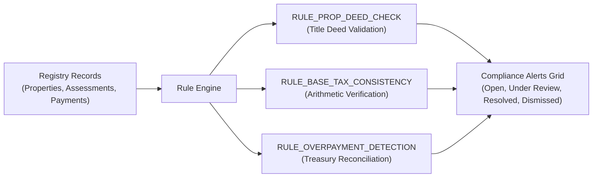

# Data Integrity & Compliance Audit Rules Guide

## 1. Overview

The CivicTax 7.0 Compliance Center uses an explainable rule-based audit engine. Unlike black-box automated systems, every detected anomaly links to an explicit municipal regulation, provides human-readable explanations, and specifies the recommended remedial action.

## 2. Active Compliance Rules Catalog

### Rule 1: Title Deed Registration Reference Check
- **Rule Identifier**: `RULE_PROP_DEED_CHECK`
- **Category**: `PROPERTY_INTEGRITY`
- **Severity**: `HIGH`
- **Trigger Condition**: Property record where `documentReference` is missing or contains fewer than 4 characters.
- **Explanation**: Property lacks a valid municipal deed registry reference or index-II document number.
- **Recommended Action**: Request citizen deed resubmission or verify registry records before approving verification.

### Rule 2: Base Tax Arithmetic Consistency Check
- **Rule Identifier**: `RULE_BASE_TAX_CONSISTENCY`
- **Category**: `ASSESSMENT_MISMATCH`
- **Severity**: `CRITICAL`
- **Trigger Condition**: `Math.abs(builtUpArea * appliedRatePerSqFt - baseTax) > 5`
- **Explanation**: The assessed base tax diverges from the calculated area multiplied by the gazetted rate per square foot.
- **Recommended Action**: Audit historical tax rate schedules and issue a corrected assessment demand.

### Rule 3: Payment Overpayment & Treasury Reconciliation Check
- **Rule Identifier**: `RULE_OVERPAYMENT_DETECTION`
- **Category**: `PAYMENT_ANOMALY`
- **Severity**: `CRITICAL`
- **Trigger Condition**: Sum of successful payments for an assessment exceeds the `totalTax` assessed.
- **Explanation**: Recorded payments exceed the total assessed amount due, indicating duplicate processing or unadjusted credits.
- **Recommended Action**: Initiate municipal treasury credit note or adjustment refund workflow.

## 3. Auditor Investigation Workflow

Auditors can review and manage alerts through the Compliance Center:
1. **Filter by Severity**: Critical, High, Medium, Low.
2. **Filter by Status**: Open, Under Review, Resolved, Dismissed.
3. **Investigate Details**: View target record reference, detection timestamp, rule description, and explanation.
4. **Take Remedial Action**: Change status to `UNDER_REVIEW` or `RESOLVED`, recording mandatory investigation notes.

## 4. UI Access & Routing

- **Administrator**: `/admin/compliance`
- **Municipal Officer**: `/officer/compliance`
