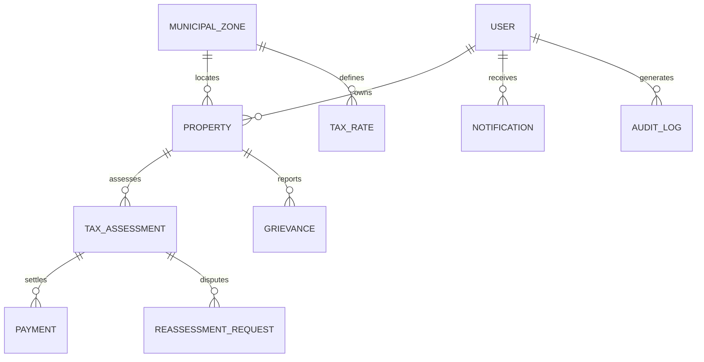

# CIVICTAX 6.0 — Database & Data Model Specification

## 1. Relational Entity Relationship Diagram

---

## 2. Comprehensive Entity Definitions

### 1. User (`src/types/index.ts`)
- `id` (UUID string, e.g. `usr-citizen-01`)
- `name` (string)
- `email` (string, unique identifier)
- `role` (`'CITIZEN' | 'OFFICER' | 'ADMIN'`)
- `phone` (string)
- `zoneId` / `zoneName` (for Officers)
- `designation` / `department` (for Officers/Admins)

### 2. Property
- `id` (UUID string, e.g. `prop-001`)
- `propertyNumber` (Unique formatted identifier, e.g. `CT-PROP-2024-001`)
- `ownerId` (Foreign Key -> User)
- `ownerName`, `ownerEmail`, `ownerPhone`, `address`
- `category` (`'RESIDENTIAL' | 'COMMERCIAL' | 'INDUSTRIAL'`)
- `zoneId`, `zoneName` (Foreign Key -> MunicipalZone)
- `builtUpArea` (Positive number in sq ft)
- `constructionYear` (Integer)
- `documentReference` (Registered title deed number)
- `verificationStatus` (`'PENDING' | 'VERIFIED' | 'REJECTED' | 'RESUBMISSION_REQUIRED'`)
- `verifiedByOfficerId`, `verifiedByOfficerName`, `verificationDate`
- `revisions` (Array of revision records)

### 3. TaxAssessment
- `id` (UUID string, e.g. `asm-001`)
- `assessmentNumber` (Unique bill identifier, e.g. `CT-ASM-2024-001`)
- `propertyId` (Foreign Key -> Property)
- `assessmentYear` (e.g. `2024-2025`)
- `appliedRatePerSqFt` (Historical rate locked at creation)
- `baseTax`, `penalty`, `discount`, `totalTax`
- `amountPaid`, `outstandingBalance`
- `status` (`'DRAFT' | 'PENDING_APPROVAL' | 'APPROVED' | 'PARTIALLY_PAID' | 'PAID' | 'OVERDUE'`)
- `dueDate`, `generatedDate`, `approvedBy`
- `isReassessed`, `previousAssessmentId` (Traceability links)

### 4. Payment
- `id`, `transactionId` (`TXN-2024-XXXX`), `receiptNumber` (`RCP-2024-XXXX`)
- `assessmentId`, `propertyId`, `payerId`
- `amountPaid`, `totalAssessment`, `remainingBalance`
- `paymentDate`, `paymentMethod` (`'UPI' | 'CREDIT_CARD' | 'DEBIT_CARD' | 'NET_BANKING'`)
- `paymentStatus` (`'SUCCESS' | 'FAILED' | 'PENDING' | 'REFUNDED'`)
- `gatewayRef`, `bankOrVpaDetails`, `remarks`

### 5. AuditLogEntry
- `id`, `actorId`, `actorName`, `actorRole`
- `action`, `recordType`, `recordId`
- `previousStatus`, `newStatus`, `description`, `timestamp`
