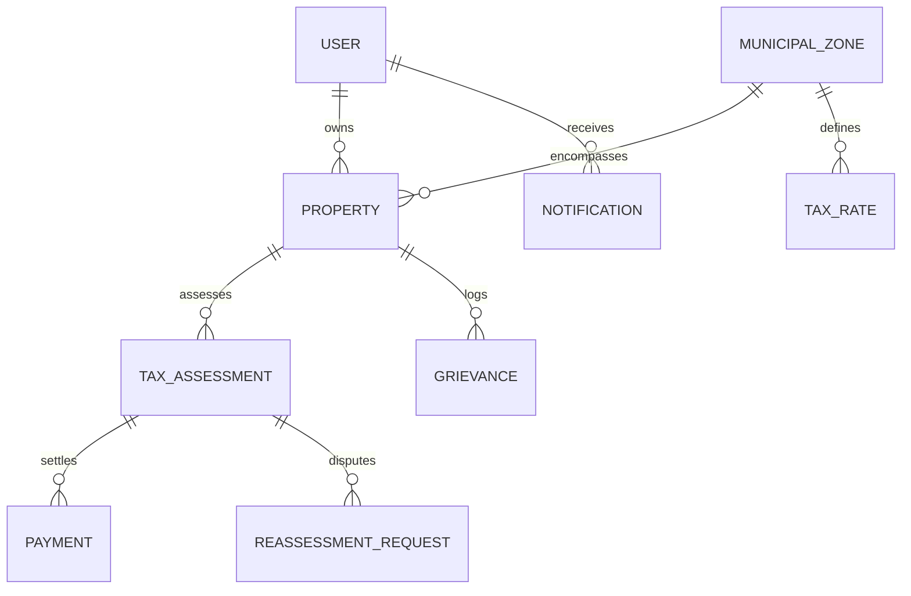

# CIVICTAX — Database Design & Schema Specification

## 1. Relational Entity Overview

---

## 2. Entity Schemas

### 1. `User` Entity
| Field | Type | Required | Description |
| :--- | :--- | :--- | :--- |
| `id` | String (UUID) | Yes | Primary key (`usr-xxx`) |
| `name` | String | Yes | Full name |
| `email` | String | Yes | Unique login identifier |
| `role` | Enum (`CITIZEN`, `OFFICER`, `ADMIN`) | Yes | Access tier |
| `phone` | String | Yes | Contact number |
| `zoneId` | String (Foreign Key) | No | Officer assigned zone |
| `designation`| String | No | Official title |
| `department` | String | No | Municipal department |

### 2. `Property` Entity
| Field | Type | Required | Description |
| :--- | :--- | :--- | :--- |
| `id` | String (UUID) | Yes | Primary key (`prop-xxx`) |
| `propertyNumber` | String | Yes | Unique municipal ID (e.g. `CT-PROP-2024-001`) |
| `ownerId` | String (Foreign Key) | Yes | ID of registering citizen |
| `ownerName` | String | Yes | Property owner title |
| `address` | String | Yes | Physical property location |
| `category` | Enum (`RESIDENTIAL`, `COMMERCIAL`, `INDUSTRIAL`) | Yes | Classification for tax assessment |
| `zoneId` | String (Foreign Key) | Yes | Municipal zone boundary |
| `builtUpArea` | Number | Yes | Total constructed area in sq ft |
| `constructionYear`| Number | Yes | Construction completion year |
| `documentReference`| String | Yes | Registered title deed / index number |
| `verificationStatus`| Enum (`PENDING`, `VERIFIED`, `REJECTED`, `RESUBMISSION_REQUIRED`) | Yes | Verification status |

### 3. `TaxAssessment` Entity
| Field | Type | Required | Description |
| :--- | :--- | :--- | :--- |
| `id` | String (UUID) | Yes | Primary key (`asm-xxx`) |
| `assessmentNumber` | String | Yes | Unique assessment bill ID (e.g. `CT-ASM-2024-001`) |
| `propertyId` | String (Foreign Key) | Yes | Linked property |
| `assessmentYear` | String | Yes | Financial year (e.g. `2024-2025`) |
| `appliedRatePerSqFt` | Number | Yes | Stamped rate per sq ft |
| `baseTax` | Number | Yes | Built-up area × Rate |
| `penalty` | Number | Yes | Late payment fee surcharge |
| `discount` | Number | Yes | Early payment discount |
| `totalTax` | Number | Yes | Base Tax + Penalty - Discount |
| `amountPaid` | Number | Yes | Total payments credited |
| `outstandingBalance`| Number | Yes | Remaining due amount |
| `status` | Enum (`DRAFT`, `PENDING_APPROVAL`, `APPROVED`, `PARTIALLY_PAID`, `PAID`, `OVERDUE`) | Yes | Current settlement state |

### 4. `Payment` Entity
| Field | Type | Required | Description |
| :--- | :--- | :--- | :--- |
| `id` | String (UUID) | Yes | Primary key (`pay-xxx`) |
| `transactionId` | String | Yes | Bank gateway transaction ref (`TXN-xxx`) |
| `receiptNumber` | String | Yes | Official tax receipt ID (`RCP-xxx`) |
| `assessmentId` | String (Foreign Key) | Yes | Linked tax assessment |
| `amountPaid` | Number | Yes | Settled payment amount |
| `paymentMethod` | Enum (`UPI`, `CREDIT_CARD`, `DEBIT_CARD`, `NET_BANKING`) | Yes | Channel used |
| `paymentStatus` | Enum (`SUCCESS`, `FAILED`, `PENDING`) | Yes | Transaction outcome |

---

## 3. Seed Dataset
The system initializes with realistic demographic test records:
- **20 Verified & Pending Properties** across Residential, Commercial, and Industrial categories.
- **15 Annual Tax Assessments** representing Paid, Partially Paid, and Overdue statuses.
- **10 Successful Payment Records** with verified receipts.
- **8 Citizen Grievances** across various resolution stages.
- **5 Reassessment Disputes** with justification notes.
