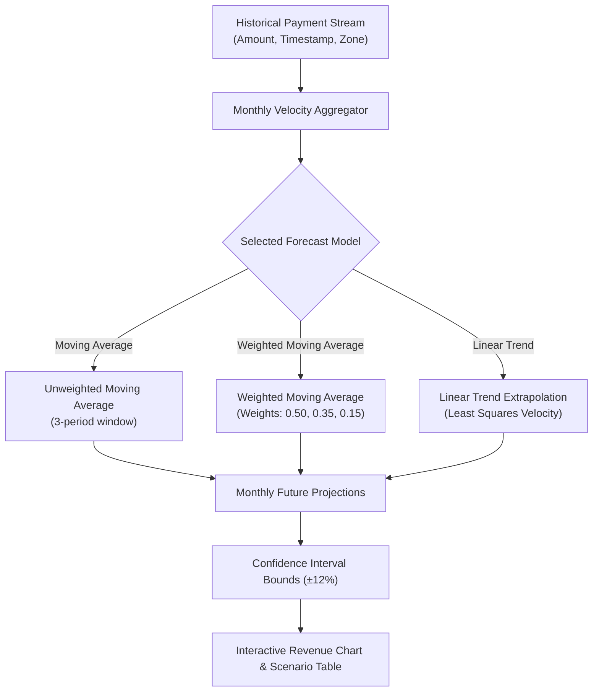

# Revenue Forecasting Methodology & Laboratory Guide

## 1. Overview

The CivicTax 7.0 Revenue Forecasting Lab provides municipal finance directors and budget planners with statistical revenue projections based on actual collection velocity and historical payment records. 

To maintain academic and professional integrity, all forecasts are derived from mathematical statistical models rather than opaque generative AI claims, ensuring full auditability.

## 2. Statistical Models Explained

### Model A: Weighted Moving Average (WMA)
- **Mathematical Form**:
  $$\text{WMA}_{t+1} = \frac{\sum_{i=1}^n w_i \cdot R_{t-i+1}}{\sum_{i=1}^n w_i}$$
- **Weights Used**: Recent month ($w_1 = 0.50$), previous month ($w_2 = 0.35$), earliest month ($w_3 = 0.15$).
- **Best For**: Capturing near-term revenue trends while accounting for recent collection drives.

### Model B: Simple Moving Average (SMA)
- **Mathematical Form**:
  $$\text{SMA}_{t+1} = \frac{1}{n}\sum_{i=1}^n R_{t-i+1}$$
- **Best For**: Baseline conservative revenue estimations that smooth out short-term fluctuations.

### Model C: Linear Trend Extrapolation
- **Mathematical Form**:
  $$R_{t+k} = R_t + k \cdot \Delta v$$
  where $\Delta v$ represents the average monthly velocity delta over the sample window.
- **Best For**: High-growth emerging municipal zones undergoing aggressive property registration.

## 3. Confidence Intervals

Each forecast point includes transparent lower and upper confidence bounds:
- **Default Variance Parameter**: $\pm 12\%$
- **Lower Bound**: $R_{\text{forecast}} \times (1 - \sigma)$
- **Upper Bound**: $R_{\text{forecast}} \times (1 + \sigma)$
- Represents potential macroeconomic variations, seasonal monsoon lulls, or fiscal year-end collection surges.

## 4. UI Access & Routing

- **Administrator**: `/admin/forecasting`
- **Interactive Controls**:
  - Model Selector (Weighted Moving Average, Moving Average, Linear Trend)
  - Forecast Horizon Selector (Next Quarter: 3 months, Next Half-Year: 6 months, Next Fiscal Year: 12 months)
  - Interactive Canvas Visualization with Legend and Confidence Bands
  - Scenario Summary Metrics: Projected Total Revenue, Average Monthly Velocity, Confidence Band Spread.
