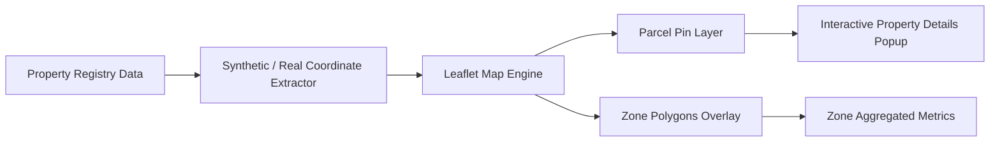

# Municipal Geospatial (GIS) Property Intelligence Guide

## 1. Overview & Purpose

The CivicTax 7.0 GIS Property Intelligence module provides municipal officers, town planners, and revenue administrators with an interactive spatial representation of registered properties across municipal zones.

## 2. Coordinate System & Synthetic Fallback

For academic and demonstration purposes where GPS surveyors have not linked individual deed plots, the system deterministically calculates synthetic coordinates centered on Pune Municipal Corporation (`18.5204° N, 73.8567° E`):

- **Zone 1 (Central Urban Core)**: Centered at `18.5204, 73.8567`
- **Zone 2 (North Tech & Residential)**: Offset north towards `18.5550, 73.8300`
- **Zone 3 (West Industrial Hub)**: Offset west towards `18.5100, 73.8100`
- **Zone 4 (South Heritage & Mixed Use)**: Offset south towards `18.4900, 73.8600`

Parcels are labeled with `geospatialVerificationStatus`:
- `VERIFIED_GPS`: On-site survey coordinates verified by field officer.
- `SYNTHETIC_DEMO`: Deterministically derived coordinates for demonstration parcels.
- `UNMAPPED`: Property registered without spatial coordinates.

## 3. Key Visual Elements & Features

### A. Dynamic Map Canvas
- Powered by `react-leaflet` and OpenStreetMap cartography.
- Smooth pan, zoom, and clustering support.
- Marker colors reflect property category:
  - **Residential**: Indigo (`#405CF5`)
  - **Commercial**: Amber (`#D97706`)
  - **Industrial**: Violet (`#7C3AED`)
  - **Agricultural / Mixed**: Teal (`#13A58B`)

### B. Interactive Parcel Popups
Clicking on any marker displays:
1. Property Number (e.g., `CT-PROP-2024-001`)
2. Owner Name and Primary Address
3. Category, Built-up Area (sq ft), and Construction Year
4. Current Verification Status (Badge)
5. Direct button to view property details or view tax assessment

### C. Zone Overlay & Filter Bar
- Filter markers by **Municipal Zone** (Central, North, West, South).
- Filter markers by **Property Category** (Residential, Commercial, Industrial).
- Filter markers by **Verification Status** (Verified, Pending, Resubmission).
- Quick statistics bar displaying Total Mapped Parcels, Zone Parcel Density, and Coverage Ratio.

## 4. Routing & Access Control

- **Administrator Route**: `/admin/gis`
- **Officer Route**: `/officer/gis`
- **Role Permissions**: Officers and Administrators have full access; Citizens do not have direct access to protect city-wide parcel privacy.
