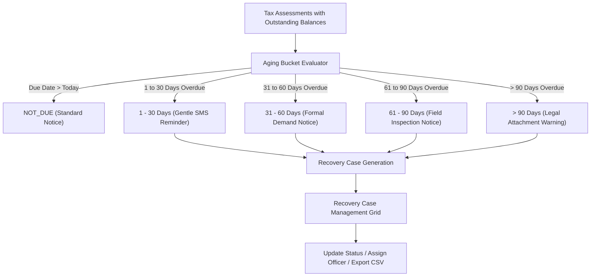

# Revenue Recovery & Arrears Aging Guide

## 1. Executive Summary

The CivicTax 7.0 Revenue Recovery Center provides revenue inspectors and municipal revenue commissioners with an automated arrears aging and delinquent tax recovery workflow. Delinquent accounts are categorized by age of default and prioritized for systematic recovery actions.

## 2. Aging Bucket Taxonomy

The aging algorithm dynamically compares the assessment `dueDate` with the current date `Date.now()`:

| Aging Bucket | Overdue Threshold | Default Priority | Recommended Municipal Action |
| :--- | :--- | :--- | :--- |
| **NOT_DUE** | 0 or negative days | `LOW` | Standard annual bill reminder sent via email/portal. |
| **1_30_DAYS** | 1 to 30 days | `MEDIUM` | Gentle SMS and email notification regarding payment deadline lapse. |
| **31_60_DAYS** | 31 to 60 days | `HIGH` | Issuance of Form-7 Municipal Demand Notice with 2% interest penalty. |
| **61_90_DAYS** | 61 to 90 days | `CRITICAL` | Ward officer field visit scheduled; property inspection notice. |
| **OVER_90_DAYS** | > 90 days | `CRITICAL` | Final statutory show-cause notice before property distraint or water disconnection. |

## 3. Case Lifecycle & Actions

Each recovery case follows a structured workflow:
1. **OPEN**: Newly generated recovery case requiring initial inspection.
2. **NOTICE_ISSUED**: Official municipal demand notice has been issued to the owner.
3. **INSPECTION_SCHEDULED**: Field officer visit has been calendared.
4. **PAYMENT_PLAN**: Citizen has entered an approved phased installment schedule.
5. **RESOLVED**: Tax assessment balance settled in full.
6. **LEGAL_ESCALATION**: Account referred to the municipal legal cell for warrant of attachment.

### Officer Actions:
- **Status Progression**: Dropdown action to advance case status with mandatory officer log notes.
- **Officer Reassignment**: Assign cases to specific ward revenue inspectors.
- **Audit Logging**: Every case change writes an immutable audit record to `civictax_audit_logs`.
- **CSV Export**: One-click export of delinquent cases with owner contact information, phone, property number, and total outstanding arrears for field teams.

## 4. UI Access & Routing

- **Administrator**: `/admin/recovery`
- **Municipal Officer**: `/officer/recovery`
