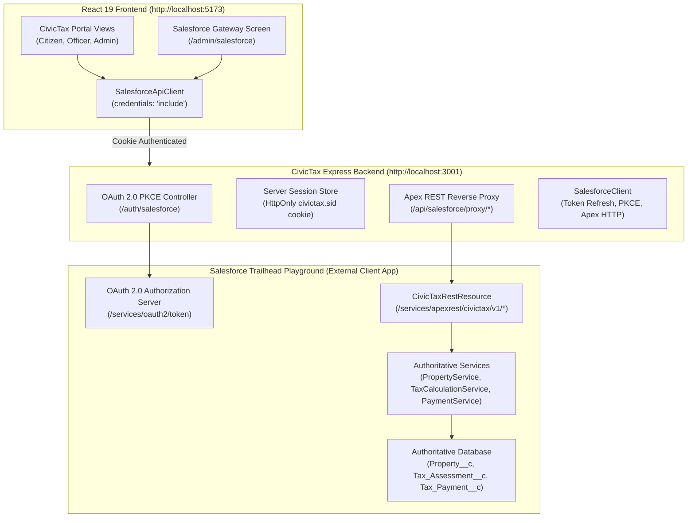

# CivicTax 8.0 Salesforce Integration Architecture

## 1. Overview & Security Topology

CivicTax 8.0 introduces an enterprise backend gateway connecting the existing CivicTax React frontend with a real Salesforce Trailhead Playground.

## 2. Zero-Leakage Security Protocol

1. **Tokens Never Reach the Browser**:
   - `access_token` and `refresh_token` are held exclusively inside server-side session memory on port `3001`.
   - The React client only communicates with the backend via `HttpOnly`, `SameSite=Lax` session cookies.
2. **PKCE (Proof Key for Code Exchange)**:
   - High-entropy code verifier is cryptographically generated using SHA-256 challenges on the backend.
3. **Authoritative Financial Calculations**:
   - Tax assessments and payment balance recalculations are executed strictly in Apex, preventing client-side price tampering.
4. **User-Mode DML & SOQL**:
   - All Apex queries and operations use `WITH USER_MODE` and `insert as user` to enforce Field-Level Security (FLS) and object permissions.
