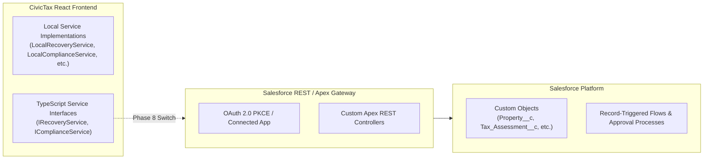

# CivicTax 7.0 to Salesforce Integration Architecture

## 1. Overview & Phased Migration Strategy

During CivicTax 1.0 through 7.0, all business logic, data models, and service interfaces have been built to mirror standard enterprise patterns while remaining completely disconnected from Salesforce. 

This document defines the direct object-to-object and API-to-service mapping for the upcoming Salesforce deployment phase without requiring frontend redesigns or architectural overhauls.



## 2. Object & Field Mapping Schema

| CivicTax 7.0 TypeScript Entity | Salesforce Custom Object | API Name | Key Mapped Fields |
| :--- | :--- | :--- | :--- |
| `Property` | Property | `Property__c` | `Property_Number__c`, `Built_Up_Area__c`, `Zone__r`, `Verification_Status__c`, `Latitude__c`, `Longitude__c` |
| `TaxAssessment` | Tax Assessment | `Tax_Assessment__c` | `Assessment_Number__c`, `Property__c`, `Fiscal_Year__c`, `Base_Tax__c`, `Total_Tax__c`, `Balance__c` |
| `Payment` | Tax Payment | `Tax_Payment__c` | `Payment_Reference__c`, `Assessment__c`, `Amount_Paid__c`, `Payment_Status__c`, `Gateway_Reference__c` |
| `Grievance` | Municipal Case / Grievance | `Case` (Record Type: `Tax_Grievance`) | `CaseNumber`, `Subject`, `Description`, `Status`, `Property__c`, `Resolution_Notes__c` |
| `MunicipalZone` | Municipal Zone | `Municipal_Zone__c` | `Zone_Code__c`, `Name`, `Ward_Coverage__c`, `Revenue_Target__c` |
| `RecoveryCase` | Recovery Case | `Recovery_Case__c` | `Case_Number__c`, `Aging_Bucket__c`, `Arrears_Amount__c`, `Assigned_Officer__c`, `Status__c` |
| `ComplianceAlert` | Compliance Finding | `Compliance_Alert__c` | `Alert_Id__c`, `Rule_Name__c`, `Severity__c`, `Status__c`, `Audit_Notes__c` |

## 3. Dependency Injection & Service Swap Pattern

The service layer is designed for a single-point switch. In `src/services/serviceContainer.ts`:

```typescript
// Current Phase (Phase 7):
export const RecoveryService = LocalRecoveryService;
export const ComplianceService = LocalComplianceService;
export const ForecastingService = LocalForecastingService;
export const TransparencyService = LocalTransparencyService;

// Future Phase (Salesforce Connection Phase):
// export const RecoveryService = SalesforceRecoveryService;
// export const ComplianceService = SalesforceComplianceService;
```

All UI components consume `RecoveryService` directly, ensuring that swapping the underlying implementation to make HTTP calls to Salesforce Apex endpoints will not require a single line of UI refactoring.
