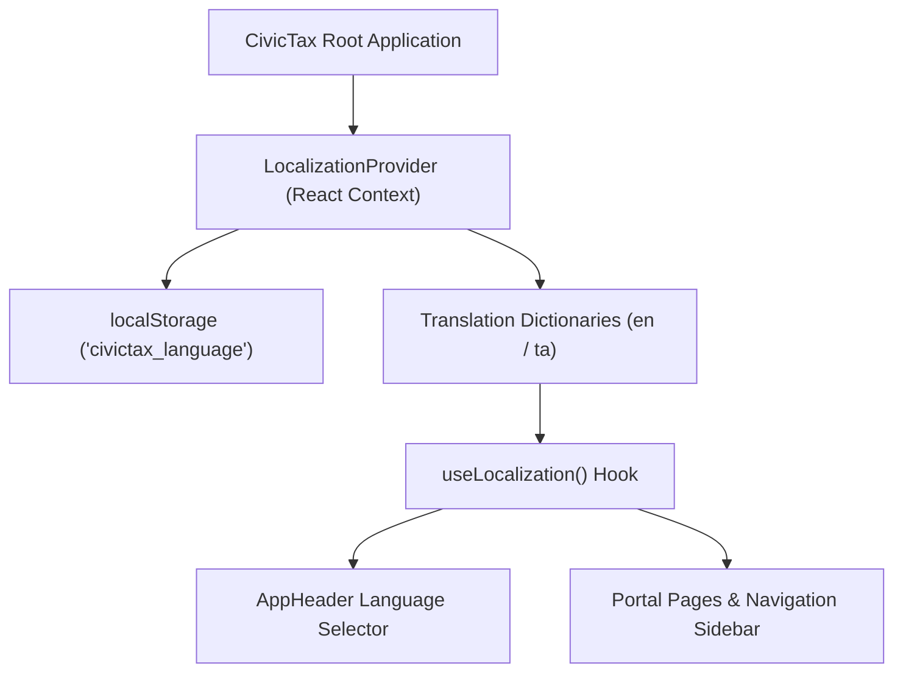

# Bilingual Support & Tamil Localization Architecture

## 1. Overview

CivicTax 7.0 introduces full bilingual support, enabling seamless switching between English and Tamil (தமிழ்). The implementation utilizes a structured dictionary approach via React Context (`LocalizationContext`), ensuring zero latency, offline readiness, and type-safe translation keys.



## 2. Supported Languages

| Language | Code | Native Name | Target Audience |
| :--- | :--- | :--- | :--- |
| **English** | `en` | English | Default administrative language & technical reviews |
| **Tamil** | `ta` | தமிழ் | Tamil-speaking citizens, municipal field staff, regional wards |

## 3. Translation Key Schema

The translation keys are structured under domain namespaces in `src/context/LocalizationContext.tsx`:

```typescript
export interface TranslationSchema {
  nav: {
    dashboard: string;
    properties: string;
    assessments: string;
    payments: string;
    grievances: string;
    gis: string;
    recovery: string;
    compliance: string;
    forecasting: string;
    transparency: string;
  };
  common: {
    appName: string;
    appTagline: string;
    login: string;
    logout: string;
    search: string;
    status: string;
    actions: string;
  };
  metrics: {
    totalProperties: string;
    totalAssessed: string;
    totalCollected: string;
    efficiency: string;
  };
}
```

## 4. Key Translated Terms

| Key | English (`en`) | Tamil (`ta`) |
| :--- | :--- | :--- |
| `nav.dashboard` | Dashboard | கட்டுப்பாட்டு பலகை |
| `nav.properties` | Properties | சொத்துக்கள் |
| `nav.assessments` | Tax Assessments | வரி மதிப்பீடுகள் |
| `nav.payments` | Payments | கட்டணங்கள் |
| `nav.grievances` | Grievances | புகார்கள் |
| `nav.gis` | GIS Map | புவிசார் வரைபடம் |
| `nav.recovery` | Revenue Recovery | வருவாய் மீட்பு |
| `nav.compliance` | Compliance Audit | இணக்க தணிக்கை |
| `nav.forecasting` | Revenue Forecast | வருவாய் முன்கணிப்பு |
| `nav.transparency` | Public Transparency | பொது வெளிப்படைத்தன்மை |
| `metrics.totalCollected` | Total Collected | வசூலிக்கப்பட்ட மொத்த வரி |
| `metrics.efficiency` | Collection Efficiency | வசூல் திறன் |

## 5. Usage in Components

Components consume translations effortlessly using the custom hook:

```tsx
import { useLocalization } from '../../context/LocalizationContext';

export const MyComponent = () => {
  const { t, language, setLanguage } = useLocalization();

  return (
    <div>
      <h2>{t('nav.gis')}</h2>
      <button onClick={() => setLanguage(language === 'en' ? 'ta' : 'en')}>
        Switch Language
      </button>
    </div>
  );
};
```
