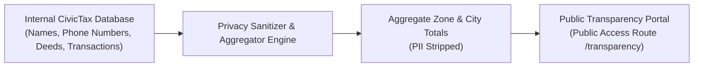

# Public Transparency Portal & Citizen Privacy Protection Guide

## 1. Overview & Policy

CivicTax 7.0 includes a dedicated Public Transparency Portal (`/transparency`) designed for citizens, journalists, and civic watchdog organizations. The portal upholds democratic accountability while strictly safeguarding citizen privacy.

## 2. Privacy Guarantees (Zero PII)

The `LocalTransparencyService` enforces strict data sanitization rules before exposing any data to the public portal:

| Protected Data Type | Treatment in Transparency Portal | Audit Verification |
| :--- | :--- | :--- |
| **Citizen Names** | **Completely Excluded**. Never serialized in public metrics. | Verified by unit test in `smartCity7.test.ts` |
| **Phone Numbers & Emails** | **Completely Excluded**. No contact info exposed. | Verified by unit test in `smartCity7.test.ts` |
| **Specific Plot Addresses** | **Aggregated to Ward / Zone Level**. Individual street addresses are withheld. | Verified in service implementation |
| **Individual Payment IDs** | **Excluded**. Only aggregate total sum of receipts per zone is displayed. | Verified by unit test in `smartCity7.test.ts` |
| **Bank Account / UPI IDs** | **Zero exposure**. Payment method breakdown is aggregated as counts/percentages. | Verified in schema |

## 3. Published Public Metrics

The Public Transparency Portal exposes the following aggregated information:

1. **City-Wide Revenue Snapshot**:
   - Total Assessed Municipal Tax (₹)
   - Total Realized Tax Revenue (₹)
   - Overall Collection Efficiency (%)
   - Total Registered Properties Across All Wards
2. **Zone Performance Table**:
   - Zone Code and Name (e.g., Zone 1 - Central Urban Core)
   - Active Mapped Property Count
   - Assessed Tax Demand vs. Actual Collections
   - Zone Collection Efficiency (%)
3. **Category-Wise Distribution**:
   - Residential, Commercial, and Industrial revenue share.
4. **Recent Civic Achievements**:
   - Resolved citizen grievances count and verification throughput.

## 4. UI Access & Public Navigation

- **Public Route**: `/transparency`
- **Access Level**: Accessible to anyone without logging in via the top navigation bar link "Public Transparency" or the direct URL.
