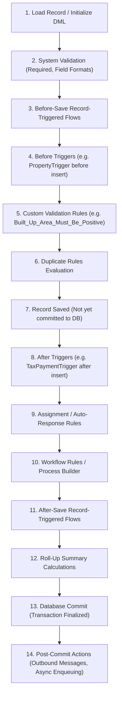

# Salesforce Trigger Architecture & Order of Execution Guide

## 1. Authoritative Order of Execution

In Salesforce, whenever a CivicTax record is saved (e.g. a Property registration or Tax Payment), the platform executes the following documented sequence:

---

## 2. CivicTax Trigger Architecture

### One Trigger Per Object Design
- `PropertyTrigger.trigger`: Handles timestamp stamping and initial default status assignments.
- `TaxPaymentTrigger.trigger`: Handles after-insert rollup into `Tax_Assessment__c` (`Amount_Paid__c`, `Outstanding_Amount__c`, `Assessment_Status__c`).

### Robust Recursion Control
To avoid infinite recursion without skipping legitimate bulk records:
1. Logic is placed inside dedicated service classes rather than raw trigger scripts.
2. Idempotent check ensures parent balances are only recalculated when payment delta $\neq 0$.
3. Bulkified collections (`Set<Id>`, `Map<Id, sObject>`) process hundreds of payments in a single transaction without hitting governor limits.
