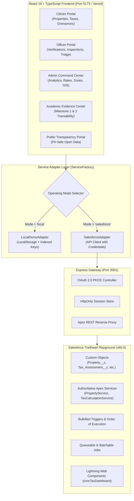

# CIVICTAX 10.0 System Architecture & Operating Modes

## 1. High-Level Architecture Overview

CivicTax is built upon a decoupled, enterprise-ready hybrid architecture designed to operate seamlessly in two distinct modes:

1. **Local Demonstration Mode (Offline / Campus Review)**:
   - Self-contained, zero-dependency mode using client-side TypeScript service layers, reactive Context state, and persistent indexed LocalStorage.
   - Ideal for faculty evaluations, offline presentations, and fast UI interaction without cloud latency or licensing barriers.
2. **Salesforce Connected Mode (Enterprise Governance)**:
   - Full-stack client-server architecture where React connects to a secure Node.js/Express backend gateway (`port 3001`), which communicates with Salesforce Apex REST endpoints (`/services/apexrest/civictax/v1/*`) via OAuth 2.0 PKCE.
   - Authoritative business logic, financial ledger entries, validation rules, triggers, and reports are executed within Salesforce.

---

## 2. Technology Stack & Component Inventory

- **Frontend Framework**: React 19, TypeScript 5.9, Vite 8.3
- **Styling**: Tailwind CSS, Lucide React icons
- **Geospatial & Mapping**: Leaflet, React-Leaflet, OpenStreetMap vector tiles
- **Backend Server**: Node.js, Express, TypeScript, express-session, cookie-parser
- **Testing**: Vitest (20 passed tests across 5 test suites)
- **Cloud Deployment**: Vercel ready (`vercel.json` SPA rewrite rules and security headers)
- **Salesforce Platform**: Salesforce DX (`v60.0`), Apex REST, Triggers, Validation Rules, Permission Sets, LWC
