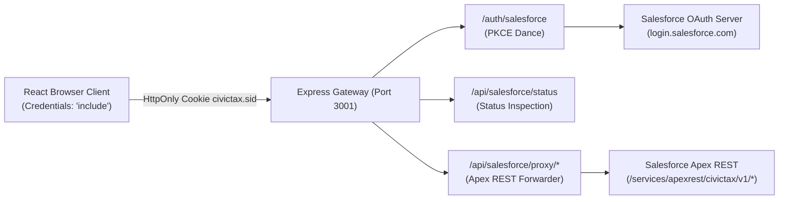

# CIVICTAX Backend Architecture

## 1. Gateway Overview & Responsibilities

The CivicTax Backend is a lightweight, highly secure Node.js & Express service located in the `server/` directory. It functions as an enterprise OAuth 2.0 PKCE and API gateway between the React frontend and Salesforce.



---

## 2. Server Architecture & Module Layout

```
server/
├── src/
│   ├── config/          # Environment configuration loader (index.ts)
│   ├── routes/          # Express route controllers (authRoutes.ts, salesforceRoutes.ts)
│   ├── services/        # SalesforceClient (Token exchange, refresh, Apex HTTP)
│   ├── types/           # Salesforce token and session types
│   ├── utils/           # PKCE crypto utilities (code verifier, challenge, state)
│   └── server.ts        # Express app bootstrap, CORS, session, and middleware
├── package.json
└── tsconfig.json
```

---

## 3. Cryptographic PKCE Flow

1. **State & Verifier Generation**:
   ```typescript
   const state = PKCEUtils.generateState(); // 32 bytes hex
   const verifier = PKCEUtils.generateCodeVerifier(64); // Base64URL string
   const challenge = PKCEUtils.generateCodeChallenge(verifier); // SHA-256 base64url
   ```
2. **Server Session Storage**:
   `req.session.oauthState = state; req.session.codeVerifier = verifier;`
3. **Authorization Redirect**:
   Browser redirected to `https://login.salesforce.com/services/oauth2/authorize` with `code_challenge` and `code_challenge_method=S256`.
4. **Token Exchange**:
   Callback verifies state against CSRF, exchanges authorization `code` + `code_verifier` for tokens, and records session in server memory.

---

## 4. Reverse Proxying to Apex REST

The `/api/salesforce/proxy/*` endpoint intercepts client API calls, attaches the active bearer token from server session memory, forwards the request to Salesforce, and automatically attempts a token refresh if a `401 Unauthorized` response is received.
