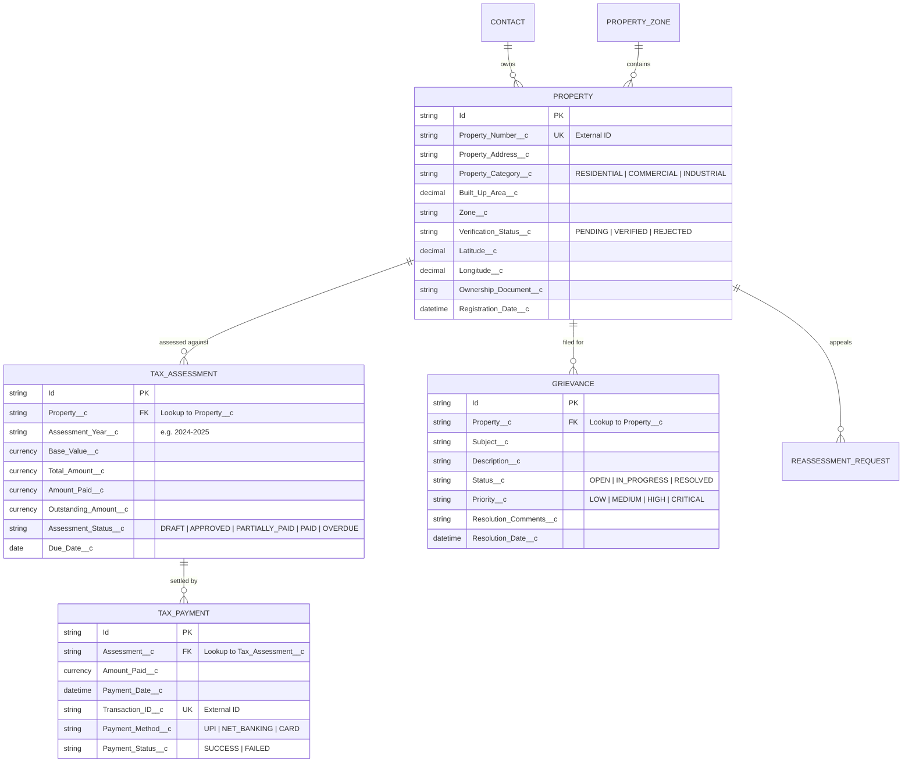

# CIVICTAX Database Architecture

## 1. Entity-Relationship Model

---

## 2. Implemented vs. Proposed Objects

| Object Name | API Name | Implementation Status | Purpose |
| :--- | :--- | :--- | :--- |
| **Property** | `Property__c` | **Implemented** | Core municipal property parcel registry with GIS coordinates. |
| **Tax Assessment** | `Tax_Assessment__c` | **Implemented** | Annual property tax bill with assessed demands and balances. |
| **Tax Payment** | `Tax_Payment__c` | **Implemented** | Financial transaction receipt records with unique transaction IDs. |
| **Grievance** | `Grievance__c` | **Implemented** | Citizen municipal service complaints and officer resolution notes. |
| **Reassessment Request** | `Reassessment_Request__c` | **Implemented** | Formal dispute appeals challenging property valuation. |
| **Tax Rate** | `Tax_Rate__c` | **Implemented** | Gazette rate matrix per sq ft across property categories. |
| **Property Zone** | `Property_Zone__c` | **Implemented** | Municipal ward boundaries and revenue targets. |
| **Recovery Case** | `Recovery_Case__c` | **Implemented** | Delinquent arrears tracking across 4 aging buckets. |
| **Compliance Alert** | `Compliance_Alert__c` | **Implemented** | Rule-based data integrity findings and officer remediation logs. |
| **Municipal Task** | `Municipal_Task__c` | *Proposed* | Officer inspection calendar and field task scheduling. |
| **Application Audit** | `Application_Audit__c` | *Proposed* | Immutable cloud ledger for administrative action auditing. |
