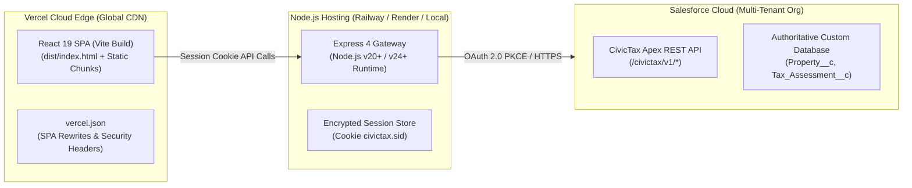
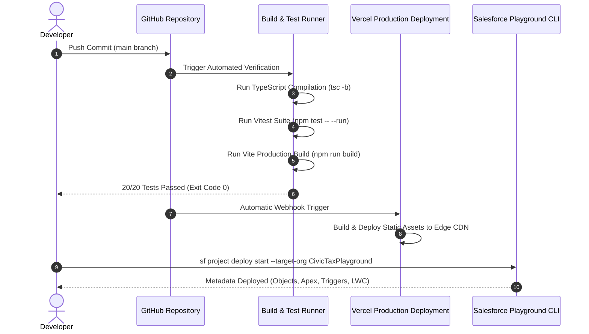

# CIVICTAX Deployment & DevOps Architecture

## 1. Cloud Infrastructure & Deployment Topology

---

## 2. CI/CD & Build Validation Workflow

---

## 3. Production Readiness Checklist

1. **SPA Rewrites**: Verified `vercel.json` rewrite configuration (`/(.*) -> /index.html`).
2. **Security Headers**: `X-Frame-Options: DENY`, `X-Content-Type-Options: nosniff`.
3. **Optimized Chunks**: Static assets compiled into versioned chunks with gzip compression (407 kB JavaScript bundle).
4. **Environment Isolation**: No production secrets in `.env.example` or frontend bundle.
