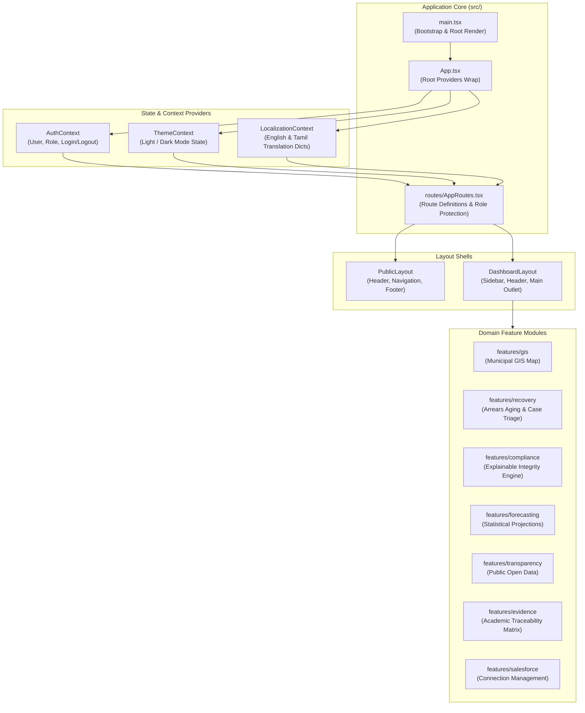

# CIVICTAX Frontend Architecture

## 1. Frontend Technology Stack & Structure

- **Framework**: React 19.0.0
- **Language**: TypeScript 5.9.3 (Strict Mode enabled)
- **Build Tool**: Vite 8.3.8 (Rollup client bundler)
- **Styling**: Tailwind CSS 3.4.19 with custom institutional design system tokens
- **Routing**: React Router DOM 7.2.0
- **Icons**: Lucide React
- **Geospatial Mapping**: Leaflet 1.9.4 & React-Leaflet 5.0.0



---

## 2. Directory Layout & Organization

```
src/
├── components/          # Reusable shared UI elements
│   ├── common/          # AppHeader, AppSidebar, Notifications, CiviAssist
│   ├── dashboard/       # Metric cards, chart widgets, activity feeds
│   ├── forms/           # Form inputs, validation decorators
│   ├── modals/          # Dialog boxes, confirmations, receipt viewers
│   └── tables/          # Data tables with search, filter, and pagination
├── context/             # React Context Providers (Auth, Theme, Localization)
├── data/                # Seed data sets (properties, users, zones, assessments)
├── features/            # High-level domain modules (GIS, Recovery, Compliance, etc.)
├── layouts/             # PublicLayout and DashboardLayout containers
├── pages/               # Top-level portal route pages (citizen, officer, admin, public)
├── routes/              # AppRoutes and ProtectedRoute guards
├── services/            # ServiceFactory, LocalAdapters, and SalesforceApiClient
├── types/               # TypeScript interface and type definitions
└── utils/               # Formatting, currency helpers, and animation constants
```

---

## 3. Localization Architecture (English & Tamil)

The frontend features dynamic runtime language switching without page reload, powered by `LocalizationContext`:
- **Key Namespaces**: `nav`, `common`, `metrics`.
- **Dictionaries**: Structured TypeScript maps (`TRANSLATIONS.en`, `TRANSLATIONS.ta`).
- **Hook API**: `const { t, language, setLanguage } = useLocalization();`
- **Persistence**: Saved to `civictax_language` in localStorage with fallback to `en`.
