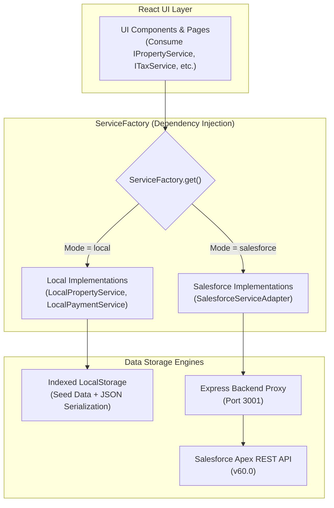

# CIVICTAX Integration Architecture

## 1. Hybrid Integration Topology

CivicTax features a modular abstraction layer (`ServiceFactory`) allowing seamless toggling between local offline persistence and enterprise Salesforce cloud synchronization.

---

## 2. Service Interface Contracts

All services adhere strictly to standard TypeScript interface contracts defined in `src/services/interfaces/index.ts`:

- `IPropertyService`: `registerProperty()`, `getProperty()`, `listProperties()`, `updateVerificationStatus()`.
- `IAssessmentService`: `getAssessments()`, `generateAssessment()`, `getAssessmentById()`.
- `IPaymentService`: `recordPayment()`, `getPaymentHistory()`, `generateReceipt()`.
- `IGrievanceService`: `submitGrievance()`, `listGrievances()`, `resolveGrievance()`.

This guarantees that switching the underlying data provider requires **zero refactoring of React pages, dialogs, or navigation hooks**.
