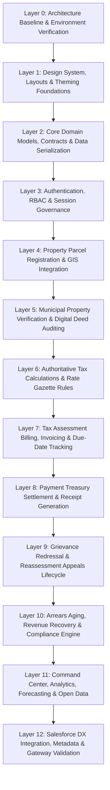

# CIVICTAX 13-Layer Master Development Execution Roadmap

This document establishes the official 13-Layer development sequence for CivicTax in compliance with the Master Architecture and Global Development Execution Rules.

---

## Layer Definitions & Execution Scope

| Layer | Layer Title | Scope & Objectives | Primary Artifacts |
| :--- | :--- | :--- | :--- |
| **Layer 0** | **Architecture Baseline & Environment Verification** | Inspect dependencies, runtime (Node.js, npm, sf), baseline tests, and document directory state. | Root configs, `package.json`, environment files |
| **Layer 1** | **Design System, Layouts & Theming Foundations** | Validate CSS design tokens (Navy, Indigo, Teal), responsive layouts, light/dark themes, and accessibility. | `tailwind.config.js`, `DashboardLayout`, `PublicLayout`, `ThemeContext` |
| **Layer 2** | **Core Domain Models & Data Serialization** | Type safety for properties, assessments, payments, grievances; indexed localStorage schemas. | `src/types/index.ts`, `storageService.ts`, `seedData.ts` |
| **Layer 3** | **Authentication, RBAC & Session Governance** | Role-based navigation guards (Citizen, Officer, Admin), demo persona switching, route security. | `AuthContext.tsx`, `ProtectedRoute.tsx`, `AppRoutes.tsx` |
| **Layer 4** | **Property Registration & GIS Integration** | Property creation form, built-up area validation, Leaflet parcel mapping, and coordinate generation. | `RegisterPropertyPage.tsx`, `MunicipalGISPage.tsx` |
| **Layer 5** | **Property Verification & Deed Auditing** | Officer inspection workflow, status updates (`VERIFIED`, `REJECTED`), audit log capture. | `PropertyVerificationPage.tsx`, `LocalPropertyService.ts` |
| **Layer 6** | **Authoritative Tax Calculation & Gazette Rules** | Built-up area × rate math, commercial/industrial multipliers, penalties, early rebates. | `businessRules.ts`, `TaxRateConfigPage.tsx` |
| **Layer 7** | **Tax Assessment Billing & Due-Date Tracking** | Assessment bill generation, overdue flags, multi-year billing records. | `CitizenAssessmentsPage.tsx`, `AdminAssessmentsPage.tsx` |
| **Layer 8** | **Payment Settlement & Receipt Generation** | Simulated UPI/Card settlement, partial payments, pessimistic balance rollup, receipt downloads. | `CitizenPaymentPortalPage.tsx`, `LocalPaymentService.ts` |
| **Layer 9** | **Grievance Redressal & Reassessments** | Citizen dispute tickets, officer investigation remarks, resolution timestamps. | `CitizenGrievancesPage.tsx`, `CitizenReassessmentsPage.tsx` |
| **Layer 10** | **Revenue Recovery & Compliance Engine** | 4-tier delinquent aging (`1-30`, `31-60`, `61-90`, `>90` days), rule-based data checks. | `RevenueRecoveryPage.tsx`, `ComplianceCenterPage.tsx` |
| **Layer 11** | **Command Center, Analytics & Open Data** | Executive dashboard, revenue velocity, statistical forecasting lab, and PII-safe public portal. | `MunicipalCommandCenter.tsx`, `PublicTransparencyPage.tsx` |
| **Layer 12** | **Salesforce DX Integration & Gateway** | OAuth 2.0 PKCE Express server, Apex REST resources, DX metadata, and Academic Evidence Center. | `server/`, `salesforce/`, `AcademicEvidenceCenter.tsx` |
