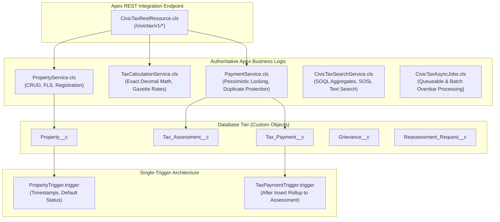

# CIVICTAX Salesforce Architecture

## 1. Multi-Tenant Architecture Overview

CivicTax utilizes the Salesforce multi-tenant platform (`API v60.0`) as its authoritative system of record and business logic engine. Custom objects, Apex classes, triggers, and Lightning Web Components are structured in a standard Salesforce DX project format under `salesforce/force-app/main/default/`.

---

## 2. Apex Service Layer & Principles

1. **Strict User-Mode Access**:
   All SOQL queries use `WITH USER_MODE`, and DML statements use `insert as user` or `update as user` to enforce Object and Field-Level Security at the platform level.
2. **Pessimistic Concurrency Control**:
   `PaymentService.cls` utilizes `SELECT ... FOR UPDATE` when querying the target assessment to prevent concurrent overpayments or race conditions.
3. **Duplicate Prevention**:
   External ID fields (`Property_Number__c`, `Transaction_ID__c`) combined with Apex pre-insert checks prevent duplicate municipal property registrations or payment replays.
4. **Bulkification**:
   Triggers and services process collections of sObjects without queries or DML statements inside loops.
