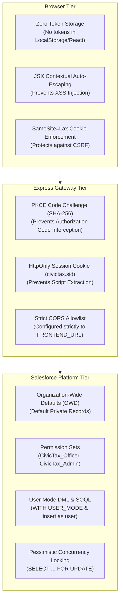

# CIVICTAX Security Architecture

## 1. Multi-Tier Security Model

CivicTax implements defense-in-depth security spanning the React frontend, Express Gateway, and Salesforce Platform.

---

## 2. Core Security Controls

### A. Zero Token Leakage Policy
- Under no circumstances are Salesforce `access_token` or `refresh_token` returned to the React frontend.
- Tokens reside strictly in server-side session memory on port 3001.

### B. Authorization Code Flow with PKCE
- Uses cryptographically generated 64-byte random code verifiers.
- Generates base64url-encoded SHA-256 code challenges for authorization calls.
- Validates random 32-byte CSRF `state` tokens upon callback.

### C. Citizen Privacy & Open Data Protection
- The Public Transparency module uses strict filtering algorithms in `LocalTransparencyService.ts` to ensure zero Personal Identifiable Information (PII) is published.
- Names, mobile numbers, email addresses, and specific street-level plot addresses are completely omitted from public aggregate responses.
