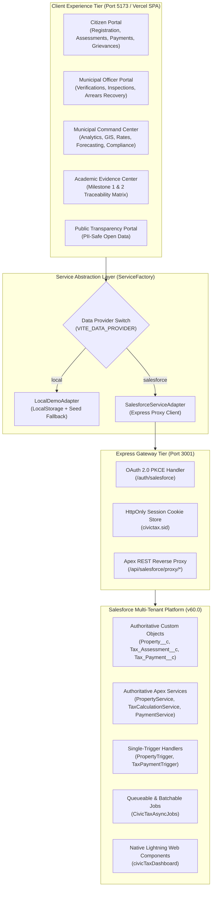

# CIVICTAX System Architecture

## 1. Executive Architectural Blueprint

CivicTax is an enterprise municipal digital governance and property tax administration platform. It operates under a dual-mode service architecture that cleanly decouples client user interaction from backend and cloud storage systems:

1. **Local Demonstration Mode (`VITE_DATA_PROVIDER=local`)**:
   - Zero-dependency client-side execution designed for rapid evaluations, campus demonstrations, and offline operation.
   - Powered by reactive React Context, in-memory adapters, and typed indexed LocalStorage.
2. **Salesforce Connected Mode (`VITE_DATA_PROVIDER=salesforce`)**:
   - Enterprise cloud tier connecting the React frontend through an Express Gateway (`port 3001`) to Salesforce Trailhead Playground/Enterprise orgs via OAuth 2.0 PKCE.
   - Authoritative business logic, financial ledger calculations, validation rules, database triggers, and reports execute natively in Salesforce.

---

## 2. Core Architectural Pillars

### A. Separation of Concerns & Clean Architecture
- **Presentation Layer**: React 19, TypeScript 5.9, Tailwind CSS. Pure UI views consume standardized interfaces from `src/services/interfaces/index.ts`.
- **Service Factory**: `ServiceFactory.ts` provides dependency injection. UI views never make direct HTTP calls or raw localStorage queries.
- **Backend Security Boundary**: No Salesforce tokens or client secrets are accessible in the browser. All token storage and exchanges occur server-side.

### B. Scalability & Resilience
- **Offline Readiness**: Operates reliably in offline classrooms via the LocalDemoAdapter.
- **High-Volume Asynchronous Processing**: Large-scale annual tax assessments and overdue accounts are delegated to Batchable and Schedulable Apex, avoiding Salesforce governor limit exhaustion.
- **Micro-State Reactivity**: Local state changes propagate seamlessly via specialized React contexts (`AuthContext`, `ThemeContext`, `LocalizationContext`).

### C. PWA & Mobile Adaptation
- Responsive grid and flexbox layout across mobile (320px+), tablet, and desktop (1920px+).
- Touch-friendly tap targets ($\ge 44\text{px}$) and reduced-motion compliance.
