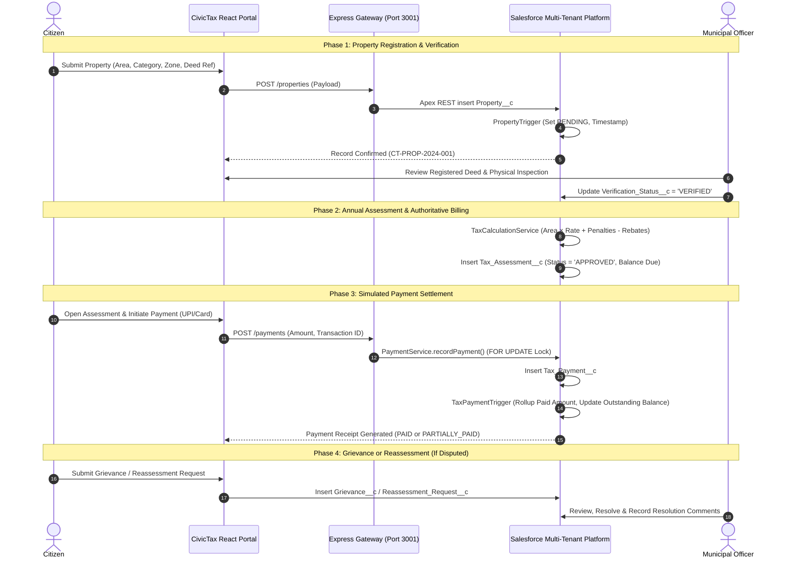

# CIVICTAX Workflow Architecture

## 1. End-to-End Municipal Tax Lifecycle



---

## 2. OAuth 2.0 PKCE Authentication Workflow

```mermaid
sequenceDiagram
    autonumber
    actor Admin
    participant Browser as React Frontend (Port 5173)
    participant Gateway as Express Gateway (Port 3001)
    participant SF as Salesforce Authorization Server

    Admin->>Browser: Click "Connect Salesforce Playground"
    Browser->>Gateway: GET /auth/salesforce
    Gateway->>Gateway: Generate state, verifier, and SHA-256 code challenge
    Gateway->>Gateway: Store state & verifier in req.session
    Gateway-->>Browser: HTTP 302 Redirect to Salesforce login
    Browser->>SF: Open Salesforce OAuth Approval Dialog
    Admin->>SF: Authenticate & Authorize CivicTax Gateway
    SF-->>Browser: Redirect to callback URL with auth code & state
    Browser->>Gateway: GET /auth/salesforce/callback?code=...&state=...
    Gateway->>Gateway: Verify state token matches session state
    Gateway->>SF: POST /services/oauth2/token (code + code_verifier)
    SF-->>Gateway: Return access_token, refresh_token, instance_url
    Gateway->>Gateway: Store tokens in session memory; issue civictax.sid cookie
    Gateway-->>Browser: Redirect to /admin/salesforce?status=success
    Browser->>Gateway: GET /api/salesforce/status (Cookie Authenticated)
    Gateway-->>Browser: Return connected: true (Zero tokens leaked)
```
