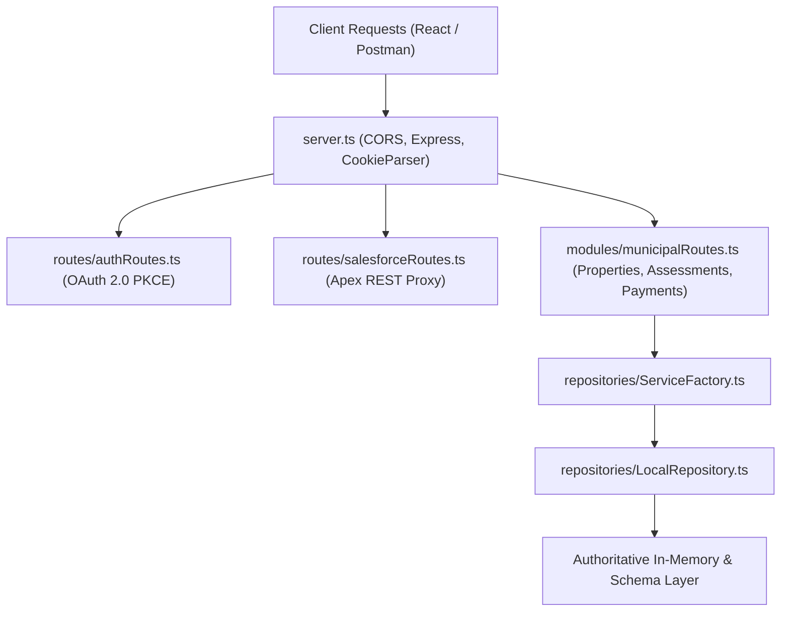

# CIVICTAX Backend Architecture & Modular Services

## 1. Modular Server Architecture



---

## 2. Directory Layout & Module Responsibilities

```
server/src/
├── config/             # Config loader (SF URLs, secrets, ports)
├── middleware/         # Session guard, logging, error handling
├── modules/            # municipalRoutes.ts (REST CRUD endpoints)
├── repositories/       # ICivicTaxRepository, LocalRepository, types.ts
├── routes/             # authRoutes.ts, salesforceRoutes.ts
├── services/           # salesforceClient.ts (Token exchange, refresh)
├── utils/              # pkce.ts (Crypto SHA-256 challenges)
├── types/              # Session and token interfaces
└── server.ts           # App bootstrap and router mounting
```
