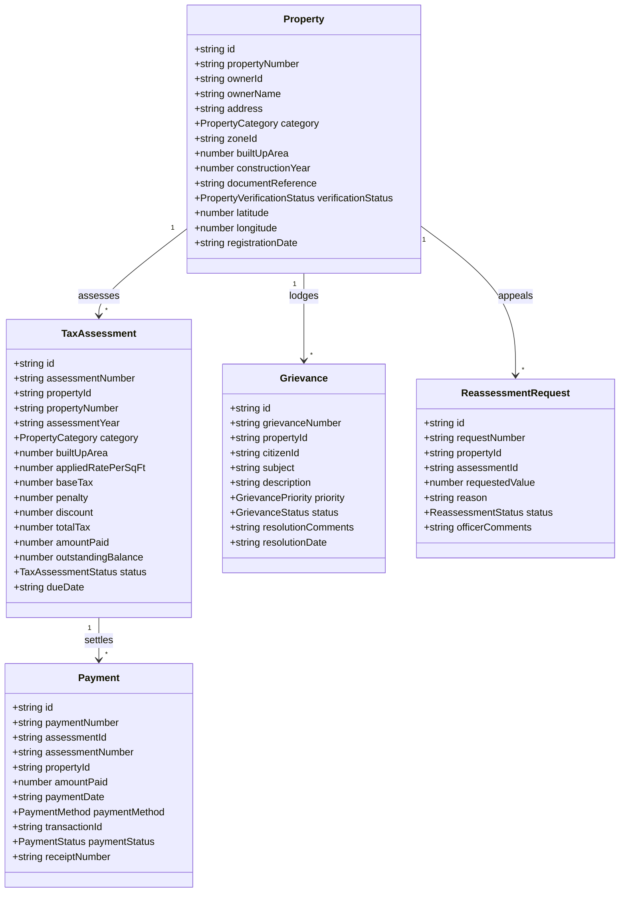

# CIVICTAX Domain Models & Entity Schema

## 1. Domain Entities Architecture

CivicTax domain entities follow strict typing in `src/types/index.ts` and Salesforce custom object mappings under `salesforce/force-app/main/default/objects/`.

---

## 2. Comprehensive Entity Definitions

### 1. `Property` / `Property__c`
- **Primary Key**: `id` (UUID / Salesforce 18-char ID)
- **Business Reference**: `propertyNumber` (Unique External ID, e.g. `CT-PROP-2024-001`)
- **Foreign Keys**: `ownerId` $\rightarrow$ `User.id` / `Contact.Id`, `zoneId` $\rightarrow$ `MunicipalZone.id`
- **Fields**:
  - `builtUpArea`: Decimal(10,2), Required, $>0$
  - `category`: Picklist (`RESIDENTIAL`, `COMMERCIAL`, `INDUSTRIAL`, `AGRICULTURAL`)
  - `verificationStatus`: Picklist (`PENDING`, `VERIFIED`, `RESUBMISSION_REQUIRED`, `REJECTED`)
  - `documentReference`: Text(100), Title deed Index-II reference
  - `latitude`, `longitude`: Decimal(10,6), WGS84 coordinates

### 2. `TaxAssessment` / `Tax_Assessment__c`
- **Primary Key**: `id`
- **Business Reference**: `assessmentNumber` (Unique External ID, e.g. `CT-ASM-2024-001`)
- **Foreign Keys**: `propertyId` $\rightarrow$ `Property.id` (Master-Detail / Restrict Delete)
- **Financial Fields**:
  - `baseTax`: Currency(14,2), Area $\times$ Rate
  - `totalTax`: Currency(14,2), BaseTax + Penalty - Discount
  - `amountPaid`: Currency(14,2), Cumulative payments rollup
  - `outstandingBalance`: Currency(14,2), TotalTax - AmountPaid
  - `status`: Picklist (`DRAFT`, `APPROVED`, `PARTIALLY_PAID`, `PAID`, `OVERDUE`)
  - `dueDate`: Date, Statutory payment deadline

### 3. `Payment` / `Tax_Payment__c`
- **Primary Key**: `id`
- **Business Reference**: `transactionId` (Unique External ID, e.g. `TXN-UPI-2024-8841`)
- **Foreign Keys**: `assessmentId` $\rightarrow$ `TaxAssessment.id` (Master-Detail)
- **Fields**:
  - `amountPaid`: Currency(14,2), $>0$, $\le$ OutstandingBalance
  - `paymentMethod`: Picklist (`UPI`, `NET_BANKING`, `CARD`, `CASH_COUNTER`)
  - `paymentStatus`: Picklist (`SUCCESS`, `FAILED`, `PENDING`)
  - `receiptNumber`: Text(50), Unique generated receipt reference

### 4. `Grievance` / `Grievance__c`
- **Primary Key**: `id`
- **Business Reference**: `grievanceNumber` (Unique, e.g. `GRV-2024-001`)
- **Foreign Keys**: `propertyId` $\rightarrow$ `Property.id`, `citizenId` $\rightarrow$ `User.id`
- **Fields**:
  - `subject`: Text(255), Required
  - `description`: LongTextArea(32000), Required
  - `priority`: Picklist (`LOW`, `MEDIUM`, `HIGH`, `CRITICAL`)
  - `status`: Picklist (`OPEN`, `IN_PROGRESS`, `RESOLVED`, `CLOSED`)
  - `resolutionComments`: LongTextArea, Mandatory on resolution
