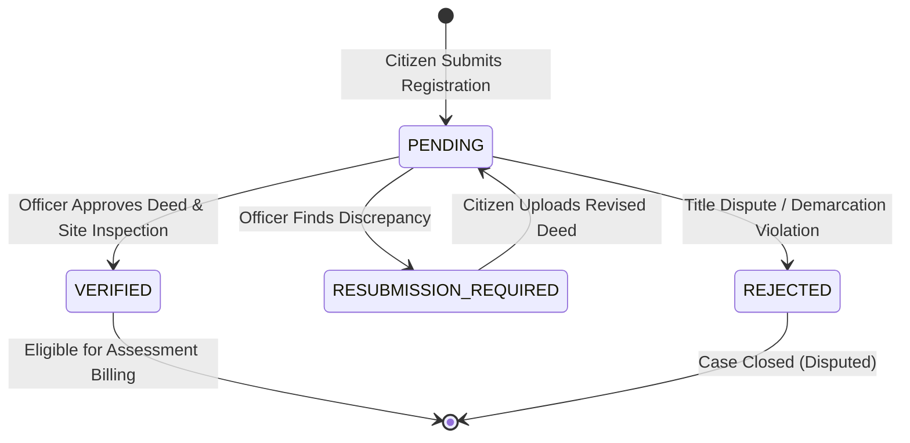
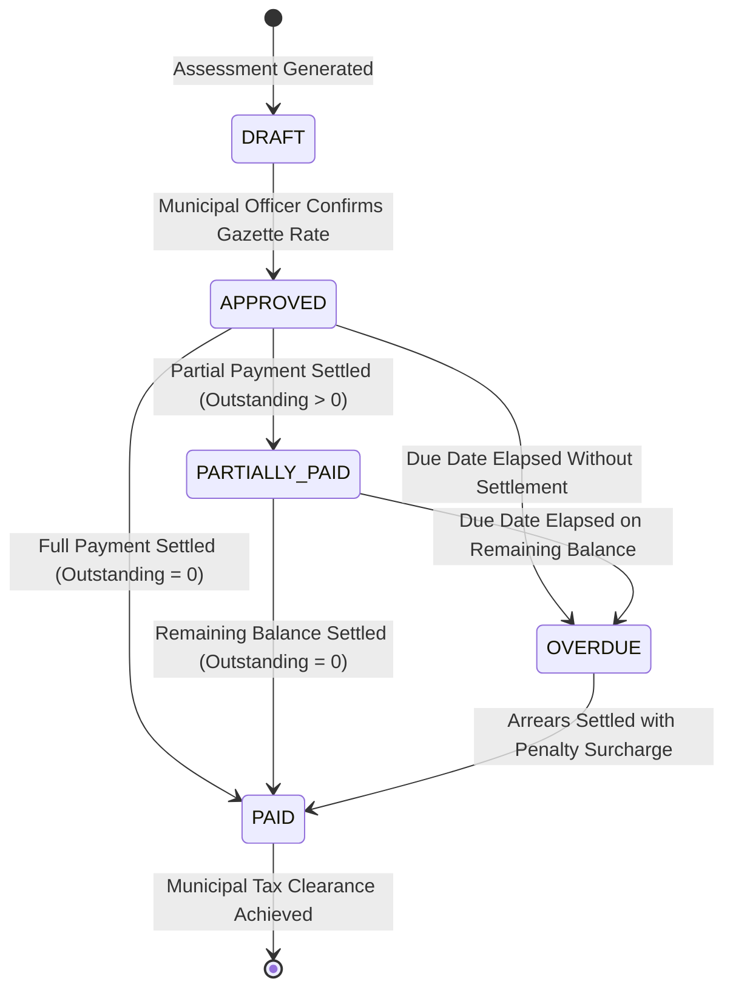
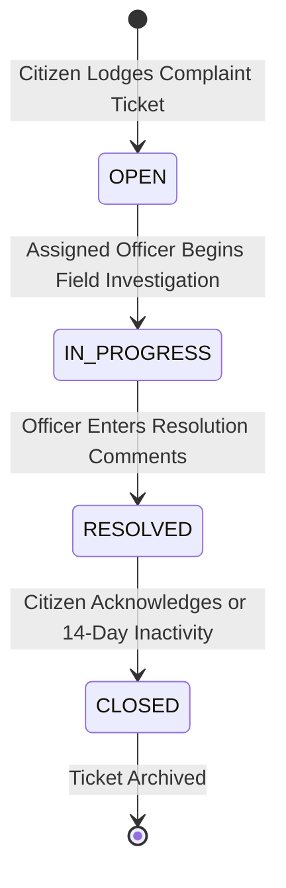

# CIVICTAX Workflow State Machines

## 1. Property Verification State Machine

- **Allowed Transitions**:
  - `PENDING` $\rightarrow$ `VERIFIED`, `RESUBMISSION_REQUIRED`, `REJECTED`
  - `RESUBMISSION_REQUIRED` $\rightarrow$ `PENDING`
- **Forbidden Transitions**:
  - `REJECTED` $\rightarrow$ `VERIFIED` (Requires new registration)
  - Direct transition to `VERIFIED` without officer review

---

## 2. Tax Assessment & Payment State Machine

- **Allowed Transitions**:
  - `DRAFT` $\rightarrow$ `APPROVED`
  - `APPROVED` $\rightarrow$ `PARTIALLY_PAID`, `PAID`, `OVERDUE`
  - `PARTIALLY_PAID` $\rightarrow$ `PAID`, `OVERDUE`
  - `OVERDUE` $\rightarrow$ `PAID`
- **Forbidden Transitions**:
  - `PAID` $\rightarrow$ `APPROVED` or `DRAFT` (Financial settlement is immutable)
  - `DRAFT` $\rightarrow$ `PAID` (Cannot pay unapproved bill)

---

## 3. Citizen Grievance State Machine

- **Mandatory Guard**: Transition to `RESOLVED` requires non-blank `resolutionComments`.
