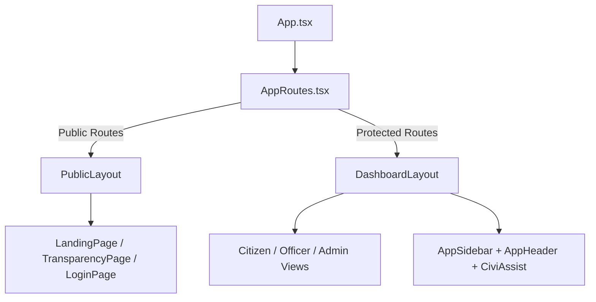

# CIVICTAX Frontend Structure & Layout Organization

## 1. Application Layout Shells

CivicTax features two primary responsive layout shells in `src/layouts/`:

1. **`PublicLayout.tsx`**:
   - Used for the Landing Page, Services, About, Contact, and Public Transparency views.
   - Includes full-width header with institutional branding, language selector, and public footer.
2. **`DashboardLayout.tsx`**:
   - Used for authenticated Citizen, Officer, and Administrator portals.
   - Combines the persistent collapsible sidebar (`AppSidebar`), institutional top bar (`AppHeader`), breadcrumbs, and floating `CiviAssist` helper.

---

## 2. Responsive Breakpoint Adaptation

| Breakpoint | Viewport Width | Layout Behavior |
| :--- | :--- | :--- |
| **Mobile (`< 768px`)** | 320px – 767px | Sidebar collapses into off-canvas mobile drawer; data tables scroll horizontally. |
| **Tablet (`md: 768px`)** | 768px – 1023px | Sidebar switches to icon-collapsed mode; 2-column grid metrics. |
| **Desktop (`lg: 1024px`)** | 1024px – 1279px| Full expanded sidebar; 3-column / 4-column KPI cards. |
| **Wide Screen (`xl: 1280px+`)** | 1280px+ | Max-width content container (7xl / 1280px) centered with balanced margins. |
