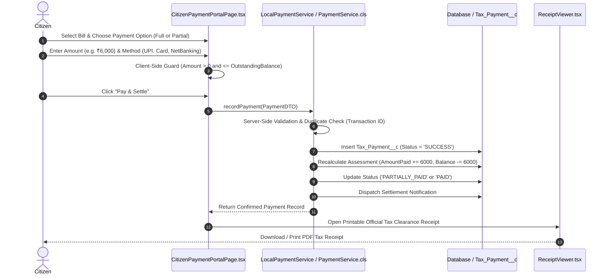

# CIVICTAX Payment Processing & Receipt Generation Specification

## 1. Simulated Payment Workflow

---

## 2. Educational Simulated Payment Notice
- **Zero Real Card / Banking Data Collection**: CivicTax strictly operates an educational simulation. No actual credit card numbers, CVVs, or bank OTPs are collected or processed.
- **Realistic Transaction Tokens**: Generates compliant transaction reference strings (e.g. `TXN-UPI-2024-98412`) for auditability.
- **Official Printable Receipt**: Formatted with municipal corporation header, QR verification code, parcel ID, tax period, breakdown, and timestamp.
