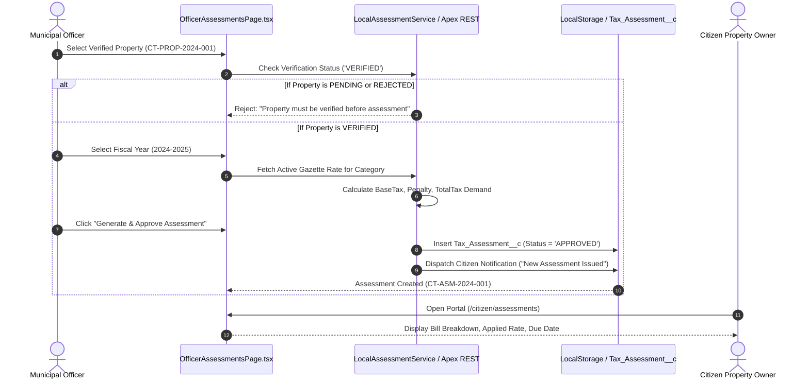

# CIVICTAX Tax Assessment Billing Lifecycle

## 1. End-to-End Assessment Workflow

---

## 2. Assessment Status State Progression

- **`DRAFT`**: Generated internally; awaiting officer rate confirmation.
- **`APPROVED`**: Active, payable municipal tax demand visible to the citizen.
- **`PARTIALLY_PAID`**: Validated installment payment recorded; balance remains $>0$.
- **`PAID`**: Fully settled assessment; outstanding balance equals ₹0.00.
- **`OVERDUE`**: Statutory payment deadline has passed with unpaid outstanding balance. Late penalty surcharge applied.
