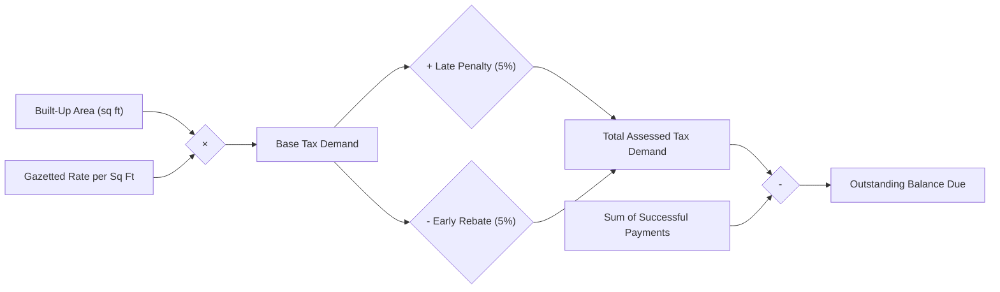

# CIVICTAX Tax Calculation Engine Specification

## 1. Authoritative Mathematical Formulas

The CivicTax tax assessment and financial calculation engine is grounded in strict mathematical formulas executed in TypeScript (`src/services/businessRules.ts`) and Salesforce Apex (`salesforce/force-app/main/default/classes/TaxCalculationService.cls`).



---

## 2. Mathematical Formalism

1. **Base Tax Demand**:
   $$\text{Base Tax} = \text{Built-Up Area (sq ft)} \times \text{Active Applied Rate per sq ft}$$
2. **Statutory Penalties & Rebates**:
   - If payment date $>$ statutory due date:
     $$\text{Late Penalty} = \text{Base Tax} \times 0.05 \quad (\text{5\% overdue surcharge})$$
   - If paid within early bird window (prior to early deadline):
     $$\text{Early Rebate} = \text{Base Tax} \times 0.05 \quad (\text{5\% prompt payment discount})$$
3. **Total Assessment Demand**:
   $$\text{Total Tax} = \text{Base Tax} + \text{Penalty} - \text{Discount}$$
4. **Outstanding Balance Invariant**:
   $$\text{Outstanding Balance} = \text{Total Tax} - \sum_{i=1}^n \text{Payment}_i \quad (\text{where } \text{Payment}_i.\text{status} = \text{'SUCCESS'})$$

---

## 3. Decimal Precision & Floating Point Protection
- Standard floating point IEEE 754 numbers (`0.1 + 0.2 !== 0.3`) are strictly forbidden for balance computations.
- Client-side calculations utilize integer cents / exact two-decimal rounding:
  ```typescript
  const baseTax = Math.round(builtUpArea * appliedRate * 100) / 100;
  ```
- Apex calculations utilize the authoritative `Decimal` type with explicit scaling:
  ```apex
  Decimal base = (builtUpArea * ratePerSqFt).setScale(2, System.RoundingMode.HALF_UP);
  ```

---

## 4. Illustrative Demonstration Gazette Rates

| Property Category | Applied Rate / Sq Ft | Multiplier Logic |
| :--- | :--- | :--- |
| **RESIDENTIAL** | ₹10.00 | Standard urban housing baseline |
| **COMMERCIAL** | ₹18.00 | High-density commercial hub multiplier (1.8×) |
| **INDUSTRIAL** | ₹24.00 | Heavy industrial and logistics warehouse rate (2.4×) |
| **AGRICULTURAL** | ₹5.00 | Agricultural and mixed rural concession (0.5×) |

*Notice: These rates are demonstration values configured in `Tax_Rate__c` and `src/data/seedData.ts` for academic evaluation.*
