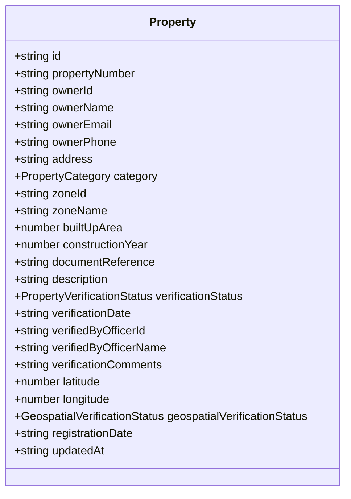

# CIVICTAX Property Management Engine & Data Model Specification

## 1. Property Entity Schema

The Property parcel model in CivicTax represents registered real estate plots across municipal wards. It is implemented in TypeScript (`src/types/index.ts`), localStorage adapters (`src/services/local/LocalPropertyService.ts`), and Salesforce custom objects (`Property__c`).

---

## 2. Field Dictionary & Technical Constraints

| Field Name | Type | Key / Constraint | Description |
| :--- | :--- | :--- | :--- |
| `id` | `string` | Primary Key | Internal record identifier (UUID / Salesforce 18-char ID) |
| `propertyNumber` | `string` | Unique External ID | Formatted municipal code (e.g. `CT-PROP-2024-001`) |
| `ownerId` | `string` | Foreign Key (`User.id`) | Registered citizen owner account identifier |
| `ownerName` | `string` | Required | Citizen full legal name |
| `address` | `string` | Required (Min 10 chars) | Physical site address including wing/flat/shop details |
| `category` | `enum` | Required | `RESIDENTIAL`, `COMMERCIAL`, `INDUSTRIAL`, `AGRICULTURAL` |
| `zoneId` | `string` | Foreign Key (`MunicipalZone.id`)| Associated administrative zone (e.g. `zone-1`) |
| `builtUpArea` | `number` | Required, $> 0$ | Total covered built-up area in square feet |
| `constructionYear`| `number` | Required, $\le$ Current Year | Year of structural completion |
| `documentReference`| `string` | Required (Min 4 chars) | Registered Sub-Registrar deed index reference |
| `verificationStatus`| `enum` | Default: `PENDING` | `PENDING`, `VERIFIED`, `RESUBMISSION_REQUIRED`, `REJECTED` |
| `latitude`, `longitude`| `number` | WGS84 decimal | GPS spatial coordinates |
| `geospatialVerificationStatus`| `enum` | Default: `SYNTHETIC_DEMO`| `VERIFIED_GPS`, `SYNTHETIC_DEMO`, `UNMAPPED` |
| `registrationDate`| `string` | ISO 8601 Timestamp | Record creation timestamp |
