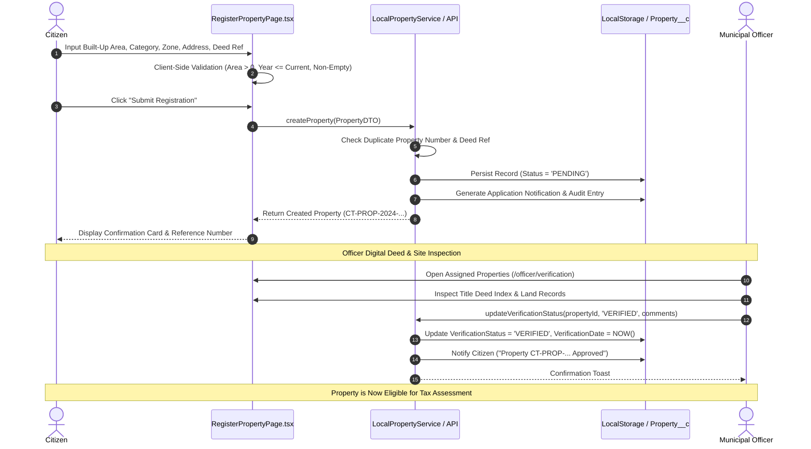

# CIVICTAX Property Registration & Verification Workflows

## 1. Citizen Registration Lifecycle

---

## 2. Multi-Tab Property Details Workspace

In `src/pages/citizen/MyPropertiesPage.tsx` and `src/pages/officer/PropertyVerificationPage.tsx`, selecting any property opens the unified workspace providing:
1. **Overview Tab**: Parcel summary, category badge, built-up dimensions, and municipal ward details.
2. **Ownership Tab**: Registered citizen legal name, email, phone, and sub-registrar deed reference number.
3. **Documents Tab**: Uploaded Index-II deed reference and municipal layout approvals.
4. **Assessments Tab**: Historical and current annual property tax bills tied to this parcel.
5. **Payments Tab**: Ledger of all settled tax receipts and transaction references.
6. **Service Requests Tab**: Linked grievances, ownership transfer tickets, and reassessment appeals.
7. **Activity History Tab**: Chronological audit trail of all status transitions and officer remarks.
