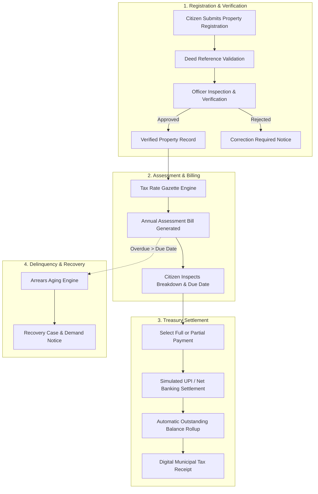

# CIVICTAX Business Requirements Document (BRD)

## 1. Executive Problem Statement & Objectives

### Problem Statement
Traditional municipal corporations manage property taxation through manual paper records, fragmented spreadsheets, and delayed physical approvals. This causes:
1. Significant tax collection leakages and uncollected delinquent arrears.
2. Inconsistent property area measurements and arbitrary tax rate applications.
3. Lack of citizen transparency regarding how assessments and late penalties are calculated.
4. Unclear grievance redressal timelines and delayed resolution of assessment disputes.

### Business Objectives
CivicTax delivers a centralized, transparent digital municipal governance platform that:
- **Democratizes Self-Service**: Enables citizens to register parcels, track approval states, and simulate payments.
- **Enforces Authoritative Calculations**: Replaces manual estimates with deterministic calculations based on active municipal gazette rates.
- **Empowers Delinquent Recovery**: Segregates arrears into 4 aging brackets (`1-30`, `31-60`, `61-90`, `>90` days) to prioritize recovery notices.
- **Promotes Digital Governance & Open Data**: Publishes PII-safe city-wide tax metrics, building civic trust while protecting citizen identities.

---

## 2. Core Business Workflows & Scope

---

## 3. High-Level Business Rules Summary

1. **Strict Verification Prerequisite**: No property can receive an approved annual tax assessment until its physical and deed documentation is formally verified by an authorized municipal officer.
2. **Deterministic Gazette Rates**: Base tax must equal Built-Up Area $\times$ Active Gazette Rate per sq ft. No arbitrary discretionary overrides are allowed.
3. **Pessimistic Balance Invariant**: Outstanding balance must strictly equal Total Tax Assessed minus cumulative successful payments. Overpayments exceeding the outstanding balance are prevented.
4. **Zero-PII Open Data Policy**: Public transparency portals publish aggregate municipal data; personal identifiers (names, phones, emails) are strictly excluded.
