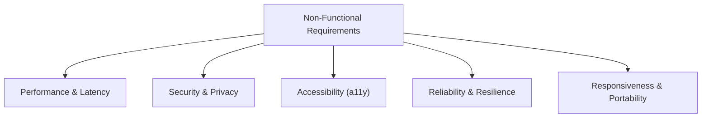

# CIVICTAX Non-Functional Requirements Specification (NFR)

## 1. Quality Attributes & Operational Parameters

---

## 2. Detailed NFR Catalog

### A. Performance & Web Vitals
- **NFR-PERF-01 (LCP Target)**: Largest Contentful Paint (LCP) must render within $\le 2.5\text{ seconds}$ on standard 4G network connections.
- **NFR-PERF-02 (INP Target)**: Interaction to Next Paint (INP) must respond within $\le 200\text{ milliseconds}$ across interactive tables, forms, and GIS filters.
- **NFR-PERF-03 (CLS Target)**: Cumulative Layout Shift (CLS) must remain $\le 0.1$, preventing visual jumping during dynamic data loading.
- **NFR-PERF-04 (Bundle Size)**: Compressed JavaScript production bundle must remain under $500\text{ kB}$ (currently verified at $407.43\text{ kB}$ gzip).

### B. Security & Cryptography
- **NFR-SEC-01 (Zero Client Tokens)**: Salesforce access and refresh tokens must never be sent to, stored in, or readable by browser JavaScript.
- **NFR-SEC-02 (Cookie Hardening)**: Session cookies (`civictax.sid`) must be marked `HttpOnly`, `SameSite=Lax`, and `Secure` in production environments.
- **NFR-SEC-03 (PKCE Standards)**: OAuth authorization must enforce RFC 7636 PKCE with high-entropy SHA-256 code challenges (`S256`).
- **NFR-SEC-04 (CORS Allowlist)**: Backend Gateway must enforce exact origin validation matching `FRONTEND_URL`; wildcard `*` origins are rejected.
- **NFR-SEC-05 (Output Sanitization)**: All CSV data exports must sanitize leading `=`, `+`, `-`, or `@` characters to prevent formula injection in Microsoft Excel.

### C. Accessibility & Usability (WCAG 2.1 AA)
- **NFR-ACC-01 (Color Contrast)**: Text-to-background contrast ratio must satisfy $\ge 4.5:1$ for normal body text and $\ge 3:1$ for bold headers.
- **NFR-ACC-02 (Keyboard Navigation)**: All forms, modal dialogs, and navigation menus must be operable via standard Tab and Enter key sequences.
- **NFR-ACC-03 (Reduced Motion)**: The application must respect system preferences for `prefers-reduced-motion: reduce` by disabling non-essential transitions.
- **NFR-ACC-04 (Bilingual Integrity)**: Language switching between English and Tamil must execute instantaneously with zero layout distortion.

### D. Data Integrity & Reliability
- **NFR-REL-01 (Pessimistic Locking)**: Payment transactions in Salesforce Apex must execute under `SELECT ... FOR UPDATE` to prevent race conditions during concurrent payments.
- **NFR-REL-02 (Exact Decimal Currency)**: Financial amounts must be represented using 14-digit precision and 2 decimal places with `HALF_UP` rounding.
- **NFR-REL-03 (Storage Schema Validation)**: LocalStorage reads and writes must pass JSON schema parsing fallbacks, preventing corrupted state on application startup.

### E. Privacy & Compliance
- **NFR-PRIV-01 (PII Exclusion)**: Public transparency endpoints must strictly strip citizen names, mobile numbers, emails, and street addresses before rendering open data metrics.
