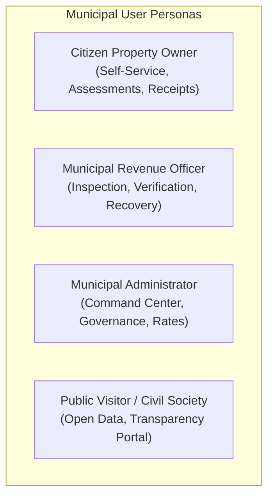

# CIVICTAX User Personas Specification

## 1. Persona Overview

CivicTax serves four primary distinct user personas reflecting real municipal property taxation and governance workflows.

---

## 2. Detailed Persona Profiles

### Persona 1: Citizen Property Owner
- **Name**: Rajesh Kumar Sharma (Representative Demo Persona)
- **Role Identifier**: `CITIZEN` (`citizen@civictax.demo`)
- **Primary Goals**:
  1. Register residential or commercial properties with deed document references.
  2. View transparent annual tax assessment bills with detailed rate calculations.
  3. Make simulated UPI, card, or net banking full and partial tax payments.
  4. Download official municipal tax clearance receipts with transaction references.
  5. Lodge grievances regarding billing errors or valuation discrepancies.
  6. Submit reassessment requests with dispute grounds and track service requests.
- **Constraints & Pain Points**: Demands mobile-friendly, instant UI without confusing legal jargon or delayed paper receipts.

---

### Persona 2: Municipal Revenue Officer
- **Name**: Priya V. Sundaram (Representative Demo Persona)
- **Role Identifier**: `OFFICER` (`officer@civictax.demo`)
- **Primary Goals**:
  1. Review pending citizen property registrations against registered deed index references.
  2. Conduct digital and on-site physical property verifications; approve, reject, or request resubmission.
  3. Review reassessment appeals and record formal officer investigation findings.
  4. Triage and resolve citizen grievances with audit remarks.
  5. Manage delinquent recovery accounts across aging buckets (`1-30`, `31-60`, `61-90`, `>90` days).
  6. Export delinquent arrears reports to CSV for field recovery enforcement teams.
- **Constraints & Pain Points**: Needs selective ward-level filtering, bulk triage capabilities, and transparent audit trails.

---

### Persona 3: Municipal Administrator & Revenue Commissioner
- **Name**: Amitabh Joshi (Representative Demo Persona)
- **Role Identifier**: `ADMIN` (`admin@civictax.demo`)
- **Primary Goals**:
  1. Monitor city-wide revenue collections, assessment targets, and zone collection efficiencies in real time.
  2. Administer municipal zone definitions, ward coverage, and officer assignments.
  3. Configure municipal gazette tax rates per sq ft across property classifications.
  4. Access the Municipal GIS Map to analyze parcel spatial density.
  5. Run statistical revenue projections in the Revenue Forecasting Lab.
  6. Audit rule-based compliance alerts in the Risk & Compliance Center.
  7. Inspect immutable chronological audit logs and manage Salesforce integration settings.
- **Constraints & Pain Points**: Requires high-level executive decision intelligence, accurate projections, and strict governance oversight.

---

### Persona 4: Public Visitor & Civil Society Observer
- **Role Identifier**: `PUBLIC` (Unauthenticated Access)
- **Primary Goals**:
  1. Access public civic services, municipal faqs, and contact directories.
  2. Browse the **Public Transparency Portal** (`/transparency`) to inspect city collection metrics.
  3. Verify aggregate zone-level revenue performance without compromising citizen privacy.
- **Constraints & Privacy Protections**: Strict zero-PII guarantee; citizen names, phone numbers, email addresses, and plot addresses are omitted from public open data.
