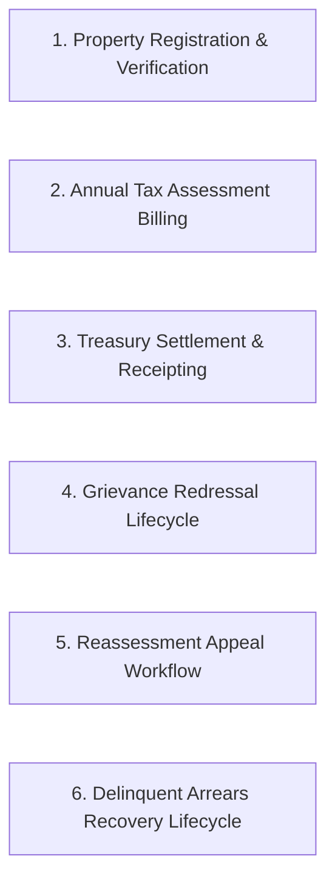

# CIVICTAX Workflow Catalog

## 1. Catalog Overview

CivicTax standardizes six primary municipal workflows governing property, revenue, dispute, and governance lifecycles.

---

## 2. Detailed Workflow Specifications

### Workflow 1: Property Registration & Verification
- **Trigger**: Citizen submits new property parcel form.
- **Inputs**: Property category, address, zone, built-up area (sq ft), construction year, title deed index number, GPS coordinates.
- **Workflow Steps**:
  1. System validates inputs against business rules (`BuiltUpArea > 0`, non-future year, unique property number).
  2. Record created with status `PENDING`.
  3. Municipal officer assigned based on municipal zone.
  4. Officer inspects deed reference and town planning records.
  5. Officer transitions status to `VERIFIED` (approved) or `RESUBMISSION_REQUIRED` (with comments).
- **Outputs**: Verified municipal parcel record eligible for tax assessment.

---

### Workflow 2: Annual Tax Assessment Billing
- **Trigger**: New financial year or verified property creation.
- **Inputs**: Property category, verified built-up area, active municipal rate gazette.
- **Workflow Steps**:
  1. System checks that target property is `VERIFIED`.
  2. Base tax calculated: $\text{Area} \times \text{Rate}$.
  3. Total amount calculated: $\text{Base Tax} + \text{Penalty} - \text{Early Rebate}$.
  4. Due date established (standard 90-day window).
  5. Assessment bill created in status `APPROVED`.
- **Outputs**: Active municipal tax bill with payment options.

---

### Workflow 3: Treasury Payment & Receipting
- **Trigger**: Citizen selects assessment bill and initiates payment.
- **Inputs**: Payment type (`FULL` or `PARTIAL`), payment amount, payment method (UPI, Card, Net Banking).
- **Workflow Steps**:
  1. System validates payment amount $>0$ and $\le$ remaining balance.
  2. Transaction processed in simulation engine with unique transaction reference.
  3. Parent assessment locked; `Amount_Paid__c` incremented; `Outstanding_Amount__c` reduced.
  4. If outstanding balance reaches 0, status updated to `PAID`; else `PARTIALLY_PAID`.
  5. Official printable tax clearance receipt generated.
- **Outputs**: Updated assessment balance, payment transaction record, and downloadable receipt.

---

### Workflow 4: Grievance Redressal Lifecycle
- **Trigger**: Citizen logs a municipal complaint.
- **Inputs**: Target property, subject, narrative description, urgency priority.
- **Workflow Steps**:
  1. Unique ticket created (e.g. `GRV-2024-001`) with status `OPEN`.
  2. Assigned to ward revenue inspector.
  3. Officer conducts investigation, records findings, and advances status to `IN_PROGRESS` then `RESOLVED`.
- **Outputs**: Resolved grievance ticket with resolution timestamp and comments.
