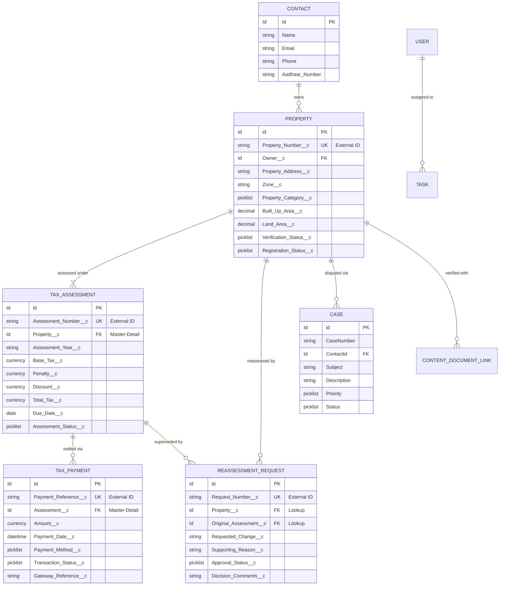

# CivicTax 6.0: Entity-Relationship Architecture & Schema Diagram

---

## 2. Integrity and Cascade Rules

1. **`Property__c` ➔ `Tax_Assessment__c` (Master-Detail)**:
   - Deleting a property automatically cleanses linked assessment dockets to prevent orphaned tax liabilities.
   - Rollup summary fields compute Total Lifetime Tax Assessed on `Property__c`.
2. **`Tax_Assessment__c` ➔ `Tax_Payment__c` (Master-Detail)**:
   - Rollup summary fields dynamically compute `Amount_Paid__c` and `Outstanding_Amount__c` on `Tax_Assessment__c`.
   - Reparenting of payment records is strictly prohibited (`reparentableMasterDetail=false`).
3. **`Property__c` ➔ `Reassessment_Request__c` (Lookup with SetNull)**:
   - Preserves legal audit records if property details are updated.
