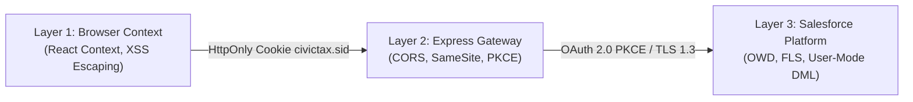

# CIVICTAX Security Configuration & Defense-in-Depth

## 1. Security Architecture Layers



---

## 2. Hardened Configuration Parameters

### A. Express Gateway Security (`server/src/server.ts`)
- **CORS Allowlist**:
  ```typescript
  app.use(cors({ origin: config.frontendUrl, credentials: true }));
  ```
  Wildcards (`*`) are strictly prohibited; only the exact configured frontend origin (`http://localhost:5173` or production domain) is accepted.
- **Session Cookie Attributes**:
  - `name`: `civictax.sid`
  - `httpOnly`: `true` (Prevents extraction via JavaScript)
  - `sameSite`: `'lax'` (Protects against CSRF attacks across sites)
  - `secure`: `true` in production (Enforces HTTPS transmission)
  - `maxAge`: `8 * 60 * 60 * 1000` (8 hours timeout)

### B. Input Validation & XSS Prevention
- All user text inputs (property addresses, grievance subjects, descriptions) are rendered through React JSX contextual auto-escaping. Zero use of `dangerouslySetInnerHTML`.
- Search queries are sanitized against script injection and SQL/SOQL injection using parameterized bindings (`WITH USER_MODE`).

### C. CSV Formula Injection Defense
- When exporting recovery reports or delinquent accounts to CSV, all fields are evaluated; leading characters matching `=`, `+`, `-`, or `@` are escaped with a prepended single quote (`'`) to prevent formula execution in spreadsheet software.
