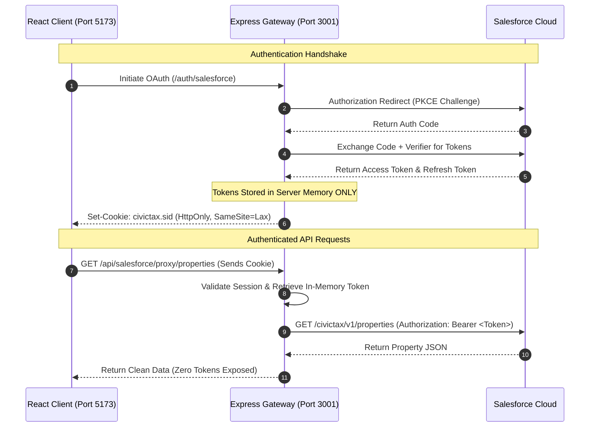

# CIVICTAX Session Security & Token Governance

## 1. Zero-Token Client Leakage Policy

CivicTax strictly guarantees that Salesforce access tokens, refresh tokens, and client secrets are **never sent to, stored in, or readable by the React client application**.

---

## 2. Session Lifecycle & Invalidation

1. **Session Creation**:
   - Successful OAuth handshake creates a server session entry mapping `userId`, `orgId`, `instanceUrl`, and encrypted tokens to the session ID.
2. **Session Idle Expiration**:
   - Sessions expire automatically after 8 hours of inactivity (`maxAge: 28800000`).
3. **Explicit Logout & Revocation**:
   - `POST /auth/salesforce/logout` destroys the server-side session, deletes tokens from memory, and clears the `civictax.sid` browser cookie.
4. **Token Refresh Automation**:
   - The Gateway detects `401 Unauthorized` responses from Salesforce, automatically requests a refreshed access token using the stored `refresh_token`, updates session memory, and transparently retries the user request.
