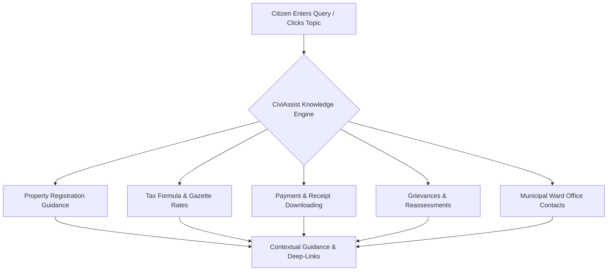

# CiviAssist Rule-Based Civic Assistant Guide

## 1. Assistant Architecture

`CiviAssist.tsx` provides an interactive floating civic assistant accessible across all CivicTax pages:

---

## 2. Integrity & Fact-Checking Rule
- **Rule-Based Truth**: CiviAssist operates as a deterministic, rule-based demonstration assistant. It answers questions using active municipal records without hallucinating tax balances or rates.
- **Deep Navigation**: Directly renders deep links to relevant forms (e.g. *"Click here to open the Payment Portal"*).
