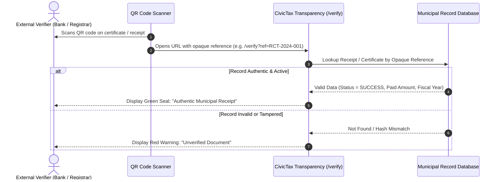

# CIVICTAX QR Verification & Public Authenticity Architecture

## 1. Opaque QR Code Verification Flow

---

## 2. Privacy & Zero-PII Policy

When external parties scan a QR verification code:
- **Exposed Data**: Property Number, Assessment Year, Amount Paid, Payment Timestamp, Authenticity Status (`VALID` or `SUPERSEDED`).
- **Strictly Excluded Data**: Citizen legal name, mobile phone number, email address, bank account details, and street-level residential flat numbers.
