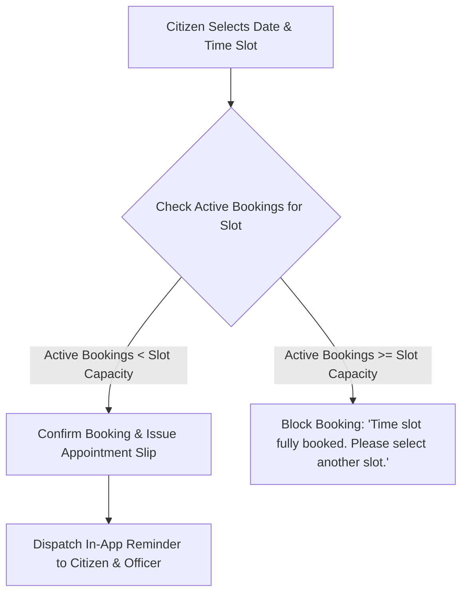

# CIVICTAX Municipal Appointment Scheduling Workflow

## 1. Appointment Management Model

The Appointment engine allows citizens to schedule in-person or virtual appointments with ward revenue officers for on-site property measurements, deed reconciliations, or hearing representations.

- **Data Fields**:
  - `appointmentId`: Unique reference (e.g. `APT-2024-001`)
  - `citizenId` / `citizenName`: Booking citizen
  - `propertyId`: Subject property parcel
  - `municipalOffice`: Ward Division Office (e.g. *Central Urban Ward 1 Office*)
  - `assignedOfficer`: Officer in charge
  - `appointmentCategory`: `PHYSICAL_INSPECTION`, `TITLE_HEARING`, `ASSESSMENT_DISPUTE`, `CERTIFICATE_VERIFICATION`
  - `appointmentDate`: Calendar date
  - `timeSlot`: Hourly slot (e.g. `10:00 AM - 11:00 AM`, `02:00 PM - 03:00 PM`)
  - `slotCapacity`: Maximum permitted bookings per slot (default: `4`)
  - `status`: `BOOKED`, `COMPLETED`, `CANCELLED`, `RESCHEDULED`, `NO_SHOW`

---

## 2. Capacity Concurrency Guard

- **Rescheduling / Cancellation**:
  - Citizens may cancel or reschedule up to 24 hours prior to the slot.
  - Cancellations immediately restore slot capacity.
