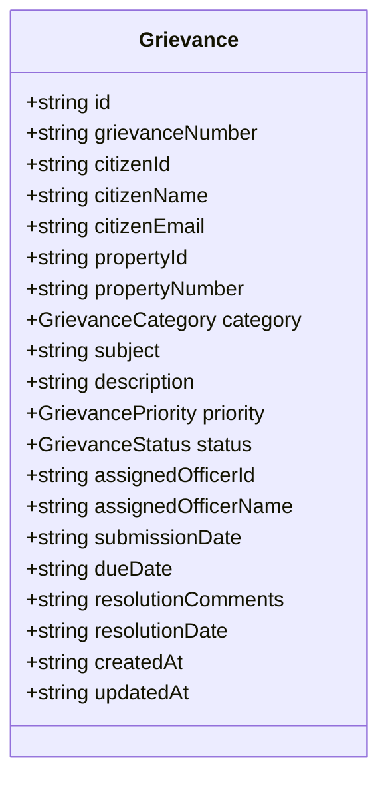
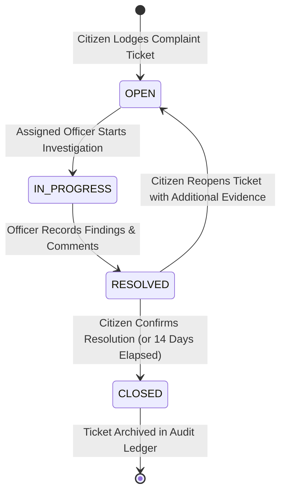

# CIVICTAX Grievance Redressal Workflow & Management Specification

## 1. Grievance Data Schema

Implemented in `src/types/index.ts` and Salesforce custom object `Grievance__c`:

---

## 2. End-to-End Workflow & State Transitions

### Workflow Steps:
1. **Citizen Submission**:
   - Citizen navigates to `/citizen/grievances`, selects target property, category (`Tax Calculation`, `Payment`, `Property Information`, `Ownership`, `Assessment`), priority, subject, and description.
   - System validates mandatory fields, generates ticket number (e.g. `GRV-2024-001`), and sets initial status `OPEN`.
2. **Officer Investigation & Triage**:
   - Officer opens `/officer/grievances` where tickets default to the officer's assigned municipal zone.
   - Officer reviews grievance details, investigates municipal rate gazette or payment receipts, and marks ticket `IN_PROGRESS`.
3. **Resolution & Audit**:
   - Officer provides mandatory resolution comments and marks ticket `RESOLVED`.
   - System timestamps `resolutionDate = NOW()` and dispatches an in-app citizen notification.
   - An immutable audit entry is recorded in `civictax_audit_logs`.
