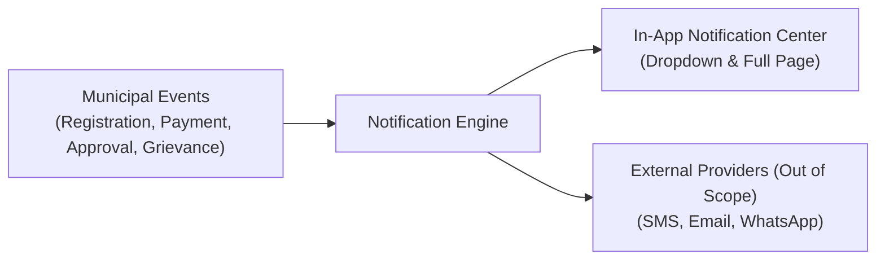

# CIVICTAX Notification Architecture & Event Dispatch Engine

## 1. Notification Event Catalog

CivicTax features an event-driven notification engine implemented in `src/services/local/LocalNotificationService.ts` and `CivicTax_Notification__c`:

---

## 2. Event Types & Templates

| Triggering Event | Recipient Persona | Notification Title | Body Template |
| :--- | :--- | :--- | :--- |
| **Property Registered** | Citizen | Registration Received | "Your property CT-PROP-... has been submitted and is currently pending officer verification." |
| **Property Verified** | Citizen | Property Approved | "Your property CT-PROP-... has been verified. You may now view annual tax assessments." |
| **Assessment Issued** | Citizen | New Assessment Bill | "Annual tax assessment CT-ASM-... for FY 2024-2025 has been issued. Total demand: ₹X." |
| **Payment Confirmed** | Citizen | Payment Succeeded | "Payment of ₹X settled successfully. Receipt RCT-... is ready for download." |
| **Due Date Reminder** | Citizen | Payment Due Soon | "Assessment CT-ASM-... is due in 15 days. Settle early to earn a 5% incentive rebate." |
| **Grievance Resolved** | Citizen | Grievance Resolved | "Grievance ticket GRV-... has been resolved. Officer remarks: X." |
| **Reassessment Decision**| Citizen | Appeal Decision | "Your reassessment request REQ-... has been reviewed and a revised bill has been generated." |

---

## 3. Storage & State Model
- **Unread Badge**: Real-time unread count indicator in the header navigation bell icon.
- **Mark as Read**: One-click "Mark All as Read" or individual notification click actions.
- **Internal vs. Citizen Separation**: Officer internal notes are stored in `internalRemarks` and are strictly excluded from citizen-facing notifications.
