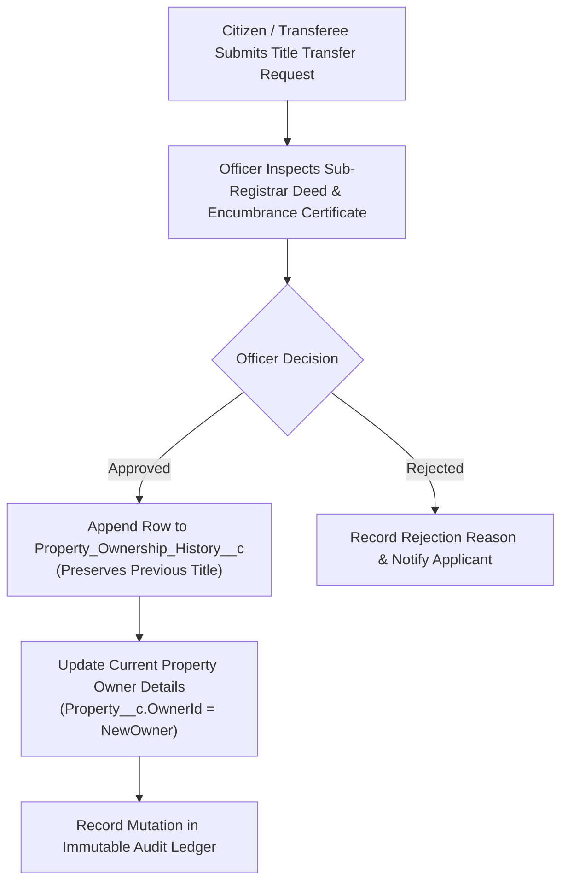

# CIVICTAX Ownership Transfer Lifecycle & Title Deed Governance

## 1. Ownership Transfer Model

Title transfer requests manage legal changes in property ownership (e.g. sale deed, inheritance, partition):

- **Data Fields**:
  - `transferRequestId`: Unique reference code (e.g. `TRF-2024-001`)
  - `propertyId`: Target property parcel
  - `currentOwnerId` / `currentOwnerName`: Existing citizen on record
  - `proposedOwnerName`, `proposedOwnerEmail`, `proposedOwnerPhone`: Transferee legal details
  - `transferCategory`: `SALE_DEED`, `INHERITANCE_SUCCESSION`, `GIFT_DEED`, `COURT_DECREE`
  - `deedReferenceNumber`: Registered sub-registrar index-II execution reference
  - `approvalStatus`: `PENDING_VERIFICATION`, `APPROVED`, `REJECTED`
  - `reviewedByOfficer`: Assigned revenue inspector
  - `transferDate`: Official effective execution date

---

## 2. Ownership History & Audit Invariant

### Invariant: Immutable Ownership Chain
- The current owner on `Property__c` cannot be updated until the municipal officer formally approves the transfer request.
- Prior ownership chains are permanently preserved in `Property_Ownership_History__c` to ensure traceability for legal dispute reviews.
