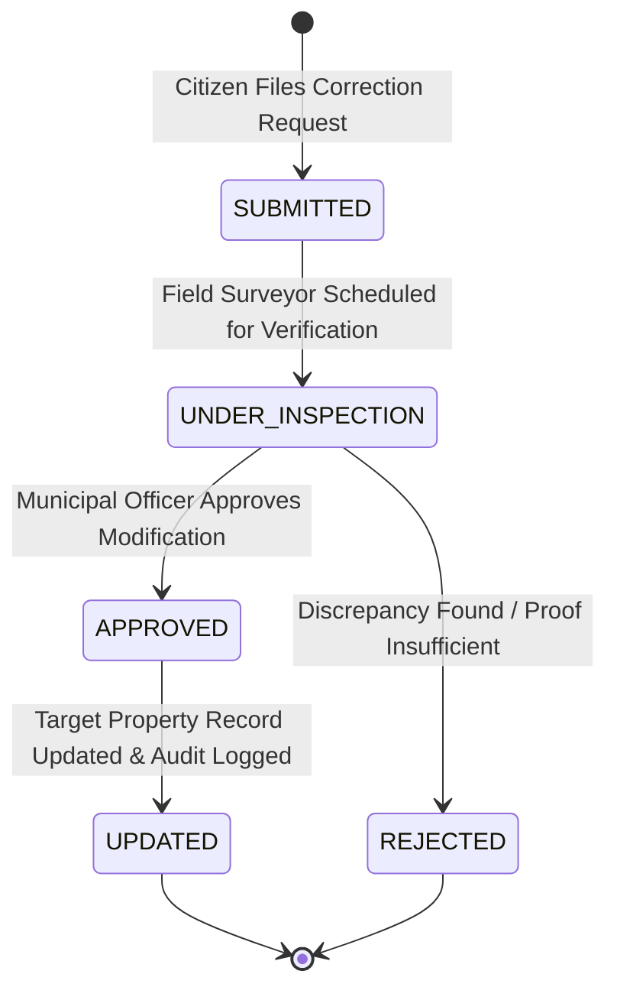

# CIVICTAX Property Correction Lifecycle & Boundary Updates

## 1. Property Correction Scope & Fields

Citizens and officers can request corrections to clerical or survey errors in registered property details:

- **Supported Correction Categories**:
  - `ADDRESS_CORRECTION`: Typographical updates to street name, flat/shop number, or postal code.
  - `AREA_MEASUREMENT_CORRECTION`: Corrections to built-up area supported by a fresh architect survey drawing.
  - `CATEGORY_RECTIFICATION`: Rectifying erroneous commercial classification for residential properties.
  - `ZONE_REALIGNMENT`: Realigning municipal ward or zone boundaries.
  - `OWNER_CONTACT_UPDATE`: Minor spelling corrections in citizen name or mobile updates.

---

## 2. Change Request Comparison Table Architecture

To prevent silent property changes, corrections store both previous and requested values:

| Field Name | Previous Registered Value | Proposed Correction Value | Justification Evidence | Officer Review Status |
| :--- | :--- | :--- | :--- | :--- |
| `builtUpArea` | `1,200 sq ft` | `1,150 sq ft` | Registered Architect Layout Plan | `PENDING_SURVEY` |
| `address` | `Flat 40, Wing B` | `Flat 402, Wing B` | Electricity Meter Sanction Order | `APPROVED` |
| `category` | `COMMERCIAL` | `RESIDENTIAL` | Electricity Tariff Domestic Bill | `APPROVED` |

---

## 3. Workflow & Approval Gate

