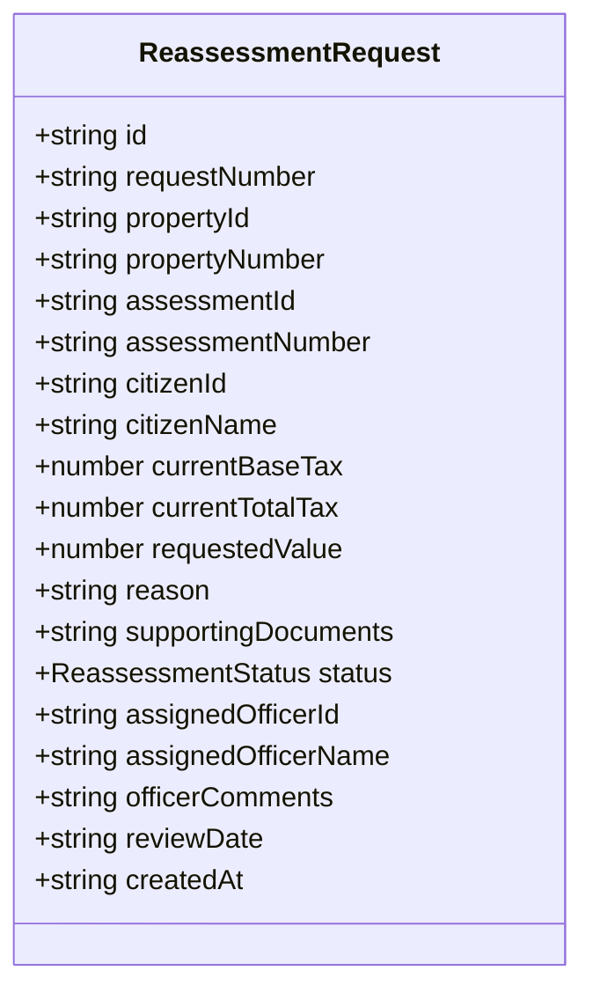
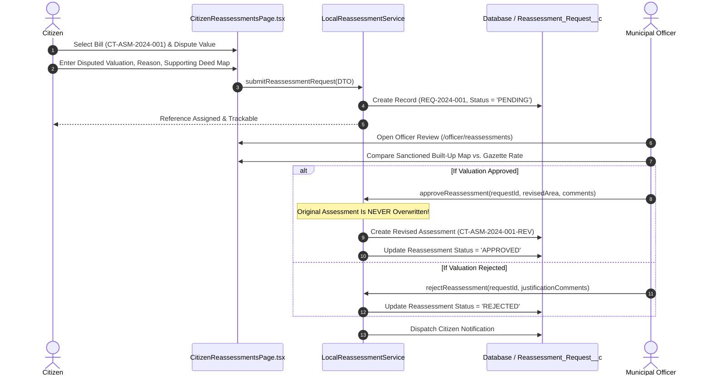

# CIVICTAX Reassessment Appeals Workflow Specification

## 1. Reassessment Entity Schema & Purpose

The Reassessment module allows citizens to formally challenge an annual tax valuation without altering or corrupting the original historical bill.

---

## 2. Reassessment Workflow & Financial Integrity Guard

### Invariant: Non-Destructive Revision
- When a reassessment is approved, the original `TaxAssessment` remains intact in the ledger as historical audit evidence.
- A new linked revision assessment (e.g. `CT-ASM-2024-001-REV`) is generated, adjusting the balance forward.
